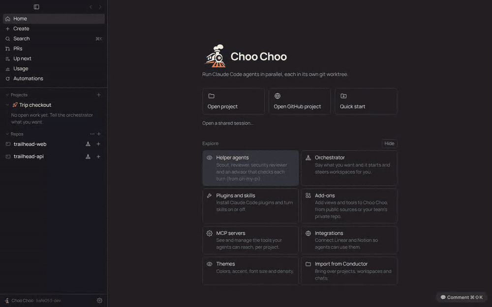
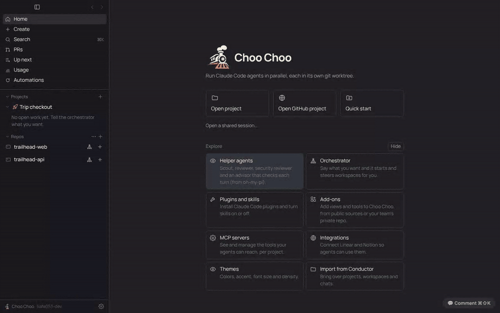
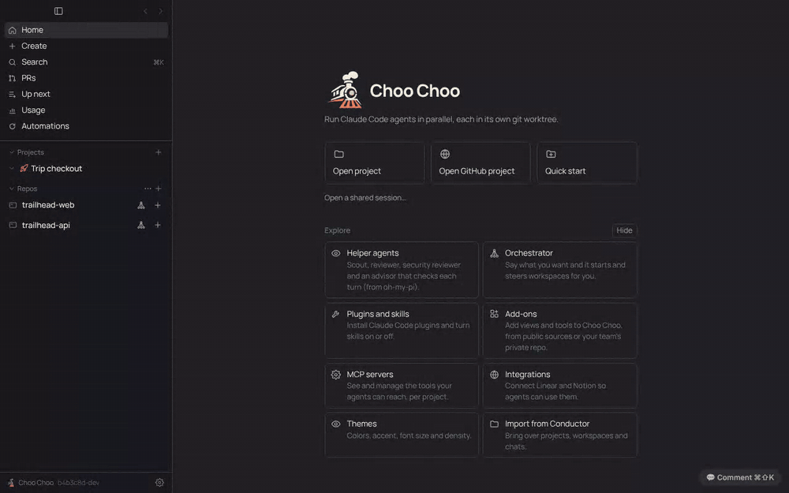
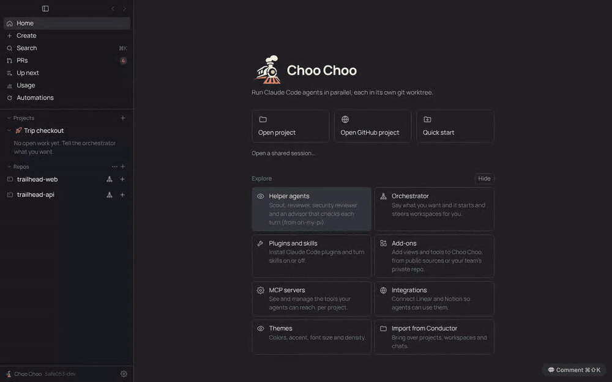
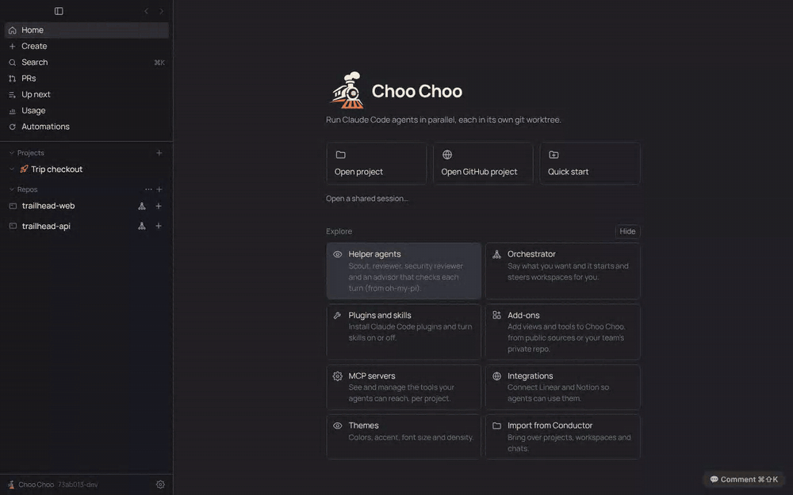
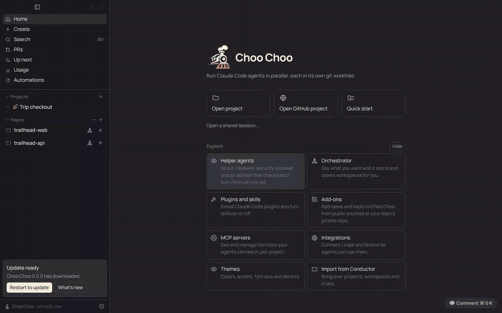

<div align="center">

<picture>
  <source media="(prefers-color-scheme: dark)" srcset="docs/brand/choo-choo-horizontal-dark.svg">
  
</picture>

**Run a team of Claude Code agents in parallel on your Mac.**<br>
Each agent gets its own git worktree. You review the diffs and ship the PRs from one window.

An open-source, MIT-licensed alternative to [Conductor](https://conductor.build).

[](https://github.com/Benbentwo/choo-choo/actions/workflows/ci.yml)
[](https://github.com/Benbentwo/choo-choo/releases/latest)
[](LICENSE)


[Download](https://github.com/Benbentwo/choo-choo/releases/latest) · [Features](#features) · [Coming from Conductor](#coming-from-conductor) · [Docs](docs/README.md) · [Contributing](#contributing)

</div>

<p align="center">
  
</p>

## Why Choo Choo

On November 4, 2026, the Conductor team [announced that Conductor is joining Meta](https://www.conductor.build/changelog/0.93.0-conductor-is-joining-meta). Conductor Cloud is winding down, and the Mac app will keep getting new models and critical bug fixes until early 2027. Congratulations to the team: they built a workflow a lot of developers now rely on.

Choo Choo is an open-source, community-driven option for people who want to keep working that way for the long run. The code is MIT-licensed, so anyone can read it, fork it and keep it going. It is built to be a drop-in switch: it follows Conductor's layout and workflow closely, and it reads the same `conductor.json` scripts and `CONDUCTOR_*` environment variables, so your repos work without changes. See [docs/PARITY.md](docs/PARITY.md) for the full feature checklist.

> Choo Choo is an independent project. It is not affiliated with, endorsed by or sponsored by the makers of Conductor or by Anthropic. "Conductor" and "Claude" are trademarks of their owners and are used here only to describe compatibility.

## Features

**Work in parallel**
- **Agents in isolated worktrees.** Press + to start a workspace: a fresh git worktree and branch where a Claude Code agent works without touching your other checkouts.
- **Chat built for coding agents.** Opus, Sonnet and Haiku with effort levels, plan mode, @file mentions, /slash commands and skills, image attachments, and "revert to here" checkpoints.
- **Stop that always stops.** Stop (or Esc) shows Stopping… right away and ends the turn within seconds. If Claude doesn't respond, Force stop ends it and everything it started, and queued messages go back to the message box.
- **Orchestrator.** Tell a repo's orchestrator what you want and it splits the work into workspaces, briefs each agent, reads their diffs and follows up.
- **Projects** (Settings > Experimental). One project per big goal, across several repos. The project chat routes each message to a thread, and each thread owns its workspaces and PRs. Automations run checks on a schedule or on GitHub events and open a workspace per finding.
- **Split panels and resizable panes.** Put workspaces and chats side by side, drag either sidebar to size it, and expand the right panel with ⌘⇧E.

<p align="center">
  <br>
  <sub>Ask a project for something; it opens a thread, which starts a workspace (git worktree and agent) in each repo it touches.</sub>
</p>

<p align="center">
  
</p>

**Review and ship**
- **Build and Review modes.** Each workspace knows whether you're building it or reviewing someone else's PR, and the top right shows the PR and one button for the next step.
- **Review before you ship.** Diffs against the PR's target branch, an agent code review with inline Fix buttons, and line comments that go to the agent or into a GitHub review.
- **PRs page.** Every open PR waiting on your review, plus your own, grouped by repo. One click opens a workspace on the PR's branch. "Since your review" shows only what the author changed.
- **Stacked PRs.** Keep a stack of PRs in one workspace, switch layers in one click, and let the app restack the PRs above after a change.
- **PRs in one click.** Create a PR or draft, watch checks, re-run failures and squash-merge, all through your `gh` login.

<p align="center">
  
</p>

**Stay on top of usage**
- **Plan limits in the sidebar**, and a **Usage page** with a year of plan window history, every limit hit, and which repos and chats used it.
- **Up next.** Chats that stop at the usage limit resume in order when the window resets, along with any work you queue for the next window.

**Make it yours**
- **Add-ons.** Claude Code plugins with a Choo Choo manifest add views, buttons and tools. Install them from any git repo, including private ones for your team. See [Writing an add-on](docs/addon-api.md).
- **Integrations.** Sign in to Notion and start a workspace from a page; agents can search and update it too. MCP servers, plugins and skills are managed in Settings.
- **Appearance.** Themes, accents, fonts, size and density.
- **Searchable Settings.** Press ⌘F in Settings and type; Enter jumps to the setting and highlights it.

<p align="center">
  
</p>

**Everywhere else**
- **Continue on your phone, in the cloud or in Claude desktop**, and bring the chat back when you return.
- **Shared sessions.** Send a coworker a link to your workspace: branch, uncommitted changes and chats.
- **Copy that pastes well.** Replies copy cleanly into Notion and Docs, or as Slack-ready text, and file links point at GitHub.
- **Real terminals.** Setup, Run (⌘R) and terminal tabs per workspace, driven by `choo-choo.json` or `conductor.json`.
- **Codex too.** Optionally run OpenAI's Codex CLI as a workspace agent.
- **Keyboard first.** ⌘K search, ⌘T/⌘W tabs, ⌘B/⌘J panels, ⌘⇧U next unread.
- **Native Mac app.** Signed and notarized builds for Apple silicon and Intel that update themselves, on a Stable or Beta channel. **What's new** shows what an update brings, and restarting waits for running chats; a chat that a restart cuts off picks up where it left off.

<p align="center">
  
</p>

## Coming from Conductor

| | Conductor | Choo Choo |
|---|---|---|
| Source code | Closed | Open, MIT license |
| Agents | Claude Code, Codex | Claude Code (official Agent SDK), Codex |
| Workspaces | Git worktrees | Git worktrees at `~/choo-choo/workspaces/<repo>/<city>` |
| Repo scripts | `conductor.json` | `choo-choo.json`, falling back to `conductor.json` |
| Env vars | `CONDUCTOR_*` | `CONDUCTOR_*`, plus `CHOO_*` aliases |
| PRs and checks | Built in | Built in, via the `gh` CLI |
| Data | On your Mac | On your Mac, plain JSON files |

To switch, [install Choo Choo](#install), [sign in](#signing-in), then open Settings > Import from Conductor. It shows a preview, then brings over your projects, open workspaces (left where they are), their chats and your default model. Claude chats keep their session, so the agent picks up with full context. Conductor's database is copied and read, never changed. Your existing `conductor.json` setup and run scripts are picked up as they are.

Using Conductor Cloud? The import reads your Mac's local Conductor data, so first move each cloud workspace to your Mac in Conductor (right-click it > Transfer to local), then import.

## Install

With [Homebrew](https://brew.sh):

```sh
brew install --cask benbentwo/tap/choo-choo
```

Or download the `.dmg` from the [latest release](https://github.com/Benbentwo/choo-choo/releases/latest) (`arm64` for Apple silicon, `x64` for Intel) and drag Choo Choo to Applications.

Builds are signed and notarized, and the app updates itself (Settings > Updates). To try new features early, pick Settings > Updates > Update channel > **Beta**: you'll get a signed build from every merge to `main`.

You'll also want the [`gh` CLI](https://cli.github.com/) (`brew install gh`, then `gh auth login`) for PR features.

## Signing in

Choo Choo runs agents through Anthropic's official [Claude Agent SDK](https://docs.claude.com/en/docs/agent-sdk/overview) and the unmodified Claude Code binary that ships with it. It never handles your Claude password or tokens itself. Use one of these:

1. **Your Claude Code login.** Install [Claude Code](https://docs.claude.com/en/docs/claude-code/setup), run `claude`, and sign in with `/login`. Choo Choo's agents use that login.
2. **An Anthropic API key.** Create one in the [Anthropic Console](https://console.anthropic.com/) and paste it into Settings > Anthropic API key, or set `ANTHROPIC_API_KEY`.

Your use of Claude is covered by Anthropic's terms for whichever sign-in you pick. Don't point Choo Choo at tools that reuse a Claude subscription by imitating Claude Code; that is against Anthropic's terms.

Codex is optional: install the Codex CLI (`npm i -g @openai/codex`) and run `codex login`.

## How it works

- Each workspace is a git worktree under `~/choo-choo/workspaces/<repo>/<city>`, on its own branch.
- App data lives in `~/Library/Application Support/Choo Choo/data`, as plain JSON files.
- Setup, run and archive scripts come from `choo-choo.json`, falling back to `conductor.json`.
- Scripts and agents see `CONDUCTOR_ROOT_PATH`, `CONDUCTOR_WORKSPACE_NAME`, `CONDUCTOR_WORKSPACE_PATH`, `CONDUCTOR_DEFAULT_BRANCH` and `CONDUCTOR_PORT`, also available as `CHOO_*`.
- The orchestrator keeps a memory file per repository at `~/choo-choo/memory/<repo>.md`, which you can edit.
- Integrations sign in through your browser (no pasted tokens), and their tokens are encrypted with the macOS keychain.
- Shared sessions are pushed to a hidden ref, `refs/choo-choo/shares/<id>`, in the repo's own remote. There is no Choo Choo server, so only people who can read the repo can open a share.
- Settings > Telemetry can send OpenTelemetry metrics, events and traces from agents to any OTLP collector. Only structure is exported unless you turn on content options.

Each feature has a PRD with the details in [docs/prd/](docs/README.md#prds).

## Contributing

Bug reports, ideas and pull requests are welcome. [CONTRIBUTING.md](CONTRIBUTING.md) covers how to send a change, and [docs/development.md](docs/development.md) covers building from source and the project docs.

## License

[MIT](LICENSE). Third-party notices are in [THIRD_PARTY_NOTICES.md](THIRD_PARTY_NOTICES.md).
