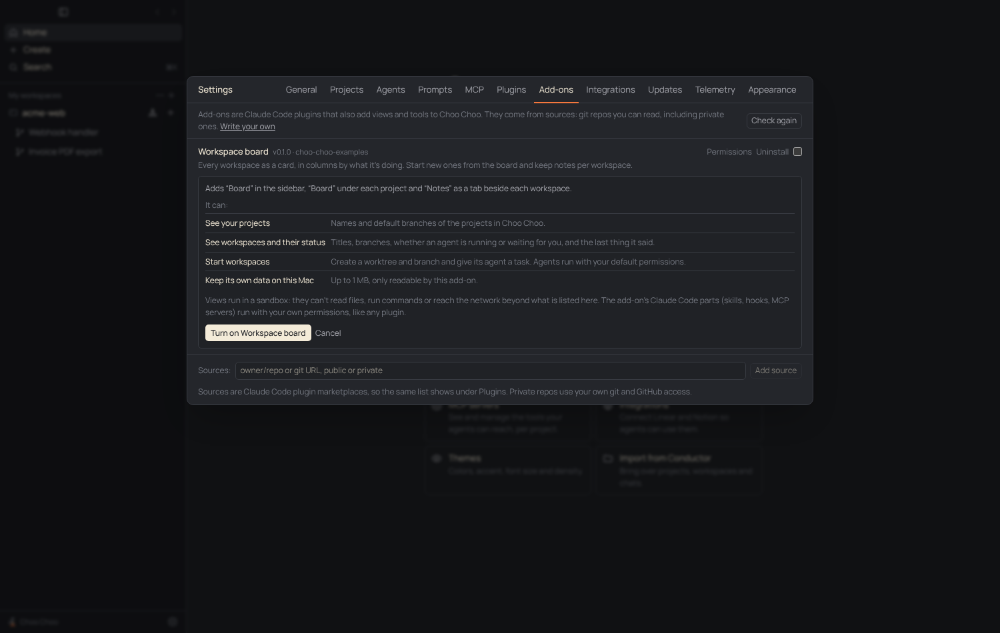
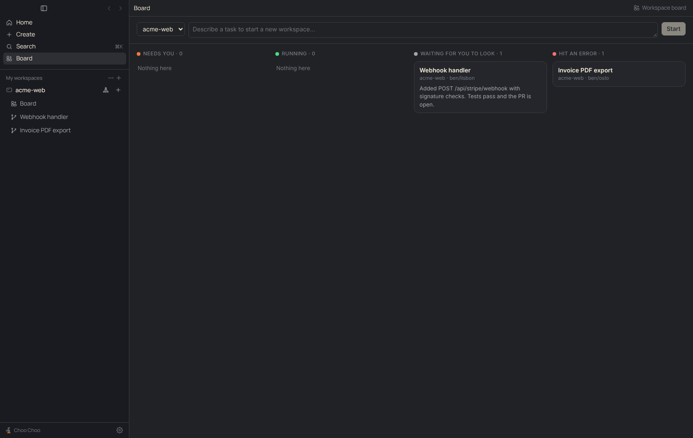
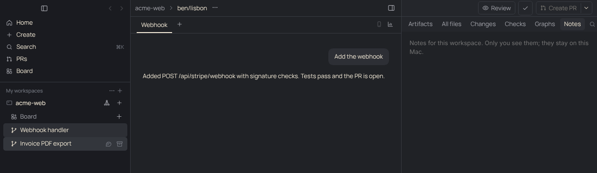

# PRD: Add-ons

| | |
|---|---|
| Status | Shipped: views, permissions and the host API (PR #55); background pages, orchestrator tools and project pins (PR #56); project files for add-ons (PR #58); buttons in the app (PR #64); pull requests by number and files in a workspace (PR #66). The Plan board, the first real add-on, is in its own repo and uses the first three |
| Owner | Claude (project thread) |
| Requested by | Ben, 2026-11-09 ("How do we support add-ons that expand functionality? Organizations can have a private add-on … so that the main project can stay open-sourced.") |
| Last updated | 2026-11-10 |

## Problem

People want Choo Choo to do things that don't belong in the core app for everyone: Ben's workplace plans large pieces of work visually and wants that to drive many workspaces at once. Organizations also need their own extensions (deploy gates, ticket systems, house styles) that only their team gets, while the app stays open source. Today the only ways to extend the app are a fork or a PR.

## Goals

- Anyone can add views and behavior to Choo Choo without changing the app.
- An organization ships add-ons to its team from a private repo. Nothing about them is public.
- Turning on an add-on is an informed choice: you see what it can do first, and it can't do more.
- Our own extensions are built the same way, starting with the Plan board (a visual plan that runs many worktree workspaces).

## Non-goals

- A Choo Choo add-on registry, store, server or account.
- Add-on code in the main process or the app window. See [decision 0006](../decisions/0006-add-ons-are-claude-code-plugins.md).
- Changing how Claude Code plugins work. Skills, hooks and MCP servers stay Claude Code's.

## User experience

**Getting an add-on.** Settings › Add-ons lists add-on sources (git repos; the same list as plugin marketplaces), the add-ons they offer, and what's installed. "Add source" takes `owner/repo`, a git URL or a folder path; private repos work through your own git and GitHub access. Install puts the add-on on your Mac but doesn't turn it on.

**Turning it on.** The switch opens a panel that says what the add-on adds ("Board in the sidebar, Notes as a tab beside each workspace") and lists each permission in plain words with a one-line explanation. "Turn on" starts it. "Permissions" shows the same list any time. Turning it off removes its views at once.

**Using it.** An add-on's views appear in up to three places: the sidebar's top list (below Search), under each project (above its workspaces), and as a tab in the right panel beside a workspace. Views follow the app's theme. Each view is labelled with the add-on it comes from.

**Buttons in the app.** An add-on can also put buttons in the app's own interface: at the top of a workspace beside Review and the pull request button, on a workspace's or a project's row in the sidebar, on its own view's row, and in the ⌘K palette. Each button's tooltip says which add-on it comes from. Pressing one opens one of the add-on's views, or has the add-on do something in the background. The panel that turns the add-on on lists every button and where it goes.

**In the background and for the orchestrator.** An add-on can keep working while its views are closed, and can give the orchestrator tools ("leave a note on each workspace saying what's left"). The panel that turns it on says so and lists the tools by name. Tools that only read run without asking; the others follow the orchestrator chat's permission setting.

**A project's add-ons.** A project can list the add-ons its team should have in its `choo-choo.json` (`addons.sources`, `addons.required`, `addons.recommended`). The project then shows "Set up Plan board" in the sidebar, and Settings › Add-ons opens with "acme-web asks for these add-ons": each with Install or Turn on, and "Not now" for recommended ones. Nothing is added or installed without a click.

**When something's off.** A row shows why an add-on isn't running: "Can't be loaded" with the manifest's problems, "Its plugin is off in Settings › Plugins", or "Paused: it asks for new permissions" with a Review button after an update that asks for more.

## Requirements

1. An add-on is an installed Claude Code plugin whose folder has a `choo-choo.addon.json`. Plugins without one are untouched.
2. A manifest with a problem is not loaded, and every problem is listed. A manifest for a newer API version says "Needs a newer Choo Choo".
3. Installed is not on. Nothing from an add-on is served or callable until the person turns it on after seeing its permissions.
4. Turning on fails if the add-on's permissions differ from what was shown. A version that asks for more pauses until reviewed.
5. Views run in frames with `sandbox="allow-scripts allow-forms"` (opaque origin, no Node, no preload, no storage, no popups, no top navigation) under a content security policy that allows only the add-on's own files and the hosts in its `net:` permissions.
6. Only files inside the add-on's folder are served, after resolving symlinks; dotfiles and dot-folders never are.
7. Every host API call is checked in the main process: the method must exist, the add-on must hold its permission, and arguments are validated. The view's identity comes from which frame sent the message, never from what it says.
8. Add-ons see live, non-orchestrator workspaces only. Reading chat transcripts is its own permission.
9. Workspaces an add-on starts are ordinary workspaces, record which add-on started them (`Workspace.addonId`), and run with the person's default model and permissions. An add-on can have at most 8 agents running at once.
10. Each add-on gets 1 MB of its own storage, readable by no other add-on.
11. With no add-on turned on, startup does no extra work and the app looks as before.
12. A background page is one more sandboxed frame per add-on, in a window that is never shown, with the add-on's own permissions and nothing more. The window exists only while an add-on that is on has a background page, and doesn't keep the app from quitting.
13. An add-on's tools are fixed by its manifest, need a background page and the `orchestrator:tools` permission, and are shown by name before it is turned on. A manifest whose tool schema can't be read is not loaded.
14. A tool call reaches only the background page of the add-on that listed the tool, and only an answer to a call that page was given is accepted. A tool that doesn't answer in five minutes fails; so do pending calls when the page restarts.
15. Pins never act on their own. Only `owner/repo` and git URLs are accepted as pinned sources (never folders), only ids the project's file names can be installed through it, and installing still ends at the permissions panel.
16. The only project files an add-on can touch are text files (`.md`, `.json`, `.txt`, `.yaml`, `.yml`, at most 1 MB) under `.choo-choo/` in a project's main checkout, with separate permissions to read and to write. Dotfiles, other paths and anything reached through a symlink are refused. With the read permission an add-on can also read the same kind of file under `.choo-choo/` in a workspace's worktree, so a plan an agent wrote there can be brought over without the agent writing outside its worktree. Writes only ever go to the main checkout.

17. An add-on's buttons are fixed by its manifest (`actions`), need the `ui:buttons` permission, and are listed with their places before it is turned on. The app draws them from the manifest's words and its own icons; no add-on code, markup or image runs or shows in the app's interface. One add-on gets at most 2 buttons per place and 8 in the palette.
18. A press reaches only the add-on that listed the button: the view the button names, opened first, or the add-on's background page. A press for the background page is checked in the main process (the add-on is on, the button is its own, the project and workspace exist) before it is passed on. Buttons never show on orchestrator chats.
19. With `prs:read` an add-on can ask for any pull request of a project by its number, not only the one a workspace is on. With `workspaces:start` it can open a pull request in a workspace: the one already on its branch, or a new one with the branch checked out. That starts no agent.

## Design

- [src/shared/addons.ts](../../src/shared/addons.ts): manifest type and `parseManifest`, the permission catalog, which permission each method needs (`METHOD_PERMISSION`), add-on states, the view CSP, and the message types between a view and the app.
- [src/main/addons.ts](../../src/main/addons.ts): finds add-ons from `claude plugin list --json` (each row's `installPath`) and available ones from each source's `marketplace.json`; safe file resolution for views.
- [src/main/addonApi.ts](../../src/main/addonApi.ts): the host API. `call()` checks the permission, validates with zod, and acts through a small `AddonHost` interface, so it has no Electron imports and is unit-tested.
- [src/main/addonHost.ts](../../src/main/addonHost.ts): registers the `choo-addon://` scheme and serves view files and `/@choo/host.js` with the CSP header; the `addons:*` IPC; grants live in `Settings.addons` (`{ enabled, granted }` per plugin id).
- [src/main/addonClient.ts](../../src/main/addonClient.ts): the script that gives a view `window.choo` over `postMessage`.
- Background pages and tools ([decision 0007](../decisions/0007-add-on-tools-run-in-a-background-page.md)): `addonHost.ts` opens the unseen window, which loads the same renderer bundle with `#addon-background` and renders only `AddonBackgrounds`. `toolsets()` hands each running add-on's tools to `orchestrator.queryOptions`, which builds one in-process MCP server per add-on (`addon-<plugin name>`). A call goes main → background window (`addons:tool`) → the add-on's frame → its handler, and back through `addons:toolResult`.
- App events for frames (`addons:event`): pull request changes and an add-on's own storage changes go to its pages in both windows; workspace changes go to the background window, which has no app state of its own.
- Pins: `parsePins` and `pinStatus` (shared and `addons.ts`), `addons:pins` and `addons:installPinned`; turned-down recommendations live in `Settings.addonPinsDismissed`.
- Buttons ([decision 0009](../decisions/0009-add-ons-declare-buttons-the-app-draws-them.md)): `parseManifest` checks `actions`; `actionTarget` says where a press goes and `addonActions` which buttons a place shows. `AddonActions` in Addons.tsx draws them in Sidebar, RightPanel and the palette, and `runAddonAction` in the store opens the view and leaves the press in `addonPress` for that view's frame, or calls `addons:action`, which checks the press (`backgroundPress` in addonApi.ts) and sends it to the background window.
- Renderer: `AddonFrame` (the frame and its message bridge) and `AddonPage` in [Addons.tsx](../../src/renderer/src/components/Addons.tsx), [AddonSettings.tsx](../../src/renderer/src/components/AddonSettings.tsx), and slots in Sidebar and RightPanel.
- Authors: [docs/addon-api.md](../addon-api.md) and the example in [examples/addons](../../examples/addons).

Add-ons are read from the home folder, so they are user-scope plugins. Sources are added, and add-ons installed, with the same `claude plugin` commands as Settings › Plugins.

## Compliance, privacy and security

- Claude access: add-ons can't run Claude or see tokens. They ask the host to start or message workspaces, which use the Agent SDK and the person's own sign-in ([0001](../decisions/0001-official-claude-access-only.md)).
- Third-party sign-in: none in this version. A host method for OAuth comes with the first add-on that needs one ([0003](../decisions/0003-oauth-for-integrations.md)).
- What leaves the machine: nothing, unless an add-on holds a `net:<host>` permission, which the person sees before turning it on. Then its views can send what their other permissions let them read to that host.
- What add-ons can't reach: files outside each project's `.choo-choo/` folder (and those only with a files permission), shell, other add-ons' files and storage, the app window, Claude tokens, integration tokens, settings. A view's frame can only move between its own add-on's pages.
- An add-on's hooks and MCP servers are Claude Code plugin parts and run with the person's permissions, as in the terminal. The permissions panel says so.
- Tools: what a tool returns goes into the orchestrator's context, so an add-on with `orchestrator:tools` can influence what the orchestrator does next. The permission says so, the tools are listed before the add-on is turned on, and the orchestrator's prompt says tool answers come from the add-on, not the person. The handler itself can do only what the add-on's permissions allow.
- Pins come from a repository's files, which anyone with push access can change. They only ever produce an offer: the source and the add-on are named, installing takes a click, and the add-on's permissions are shown before it runs.

## Testing

`test/addons.test.ts` covers manifest validation (views, background page, tools), permissions and states, the CSP, finding installed and available add-ons, pins, file serving (traversal, symlinks, dotfiles), the client script including tool handlers, button presses and events, buttons (manifest rules, where a press goes, which buttons a place shows, what the background page is told), and every host API method against a fake host. `test/orchestrator.test.ts` covers add-on tools reaching the orchestrator. Its buttons were pressed in the built app in all five places, with the press reaching the right view or the background page, and gone again once the add-on was turned off. The example add-on was run in the real app under Playwright: install from a local source, turn on, all three slots, and probes from inside a view confirming it has no `require`, no `window.api`, no access to the parent window, no outside network, no other add-on's files, no calls beyond its permissions, and no way to send its frame to a web page or another add-on's pages. Background pages, tools and pins were run the same way: a project pinning the example showed its sidebar row and Settings section, Install and Turn on led to the permissions panel, the unseen window came up (and again after a restart, before any view was opened), both tools were called through the same function the orchestrator's tools call, a note written by a tool appeared in the open Notes view, and turning the add-on off closed the window. Not run: a real orchestrator turn calling an add-on tool, which needs a Claude sign-in the test machine doesn't have.

## Rollout

Off until an add-on is installed and turned on. `Settings.addons` and `Workspace.addonId` are optional, so old saves need no migration.

## Open questions

- Per-repo add-ons: should an add-on be on for chosen projects only? Today it is on for all.
- Should a button be able to change while the app runs (hidden where it doesn't apply, disabled, a count)? Today it is fixed by the manifest.
- Should turning an add-on off also disable its Claude Code plugin parts? Today Settings › Plugins controls those separately.

## Future work

1. Plan board, which lives in its own repo and keeps plans as files under `.choo-choo/plans/` through `choo.files`: editing dependencies by dragging, a kanban view, review findings on cards, a spend cap.
2. More places for add-ons: a tab in the bottom panel beside the terminal, a strip above the composer, badges on sidebar rows.
3. Workspace sources ("New plan from…"), an OAuth host method, a template repo for private add-ons, managed settings for fleets.
