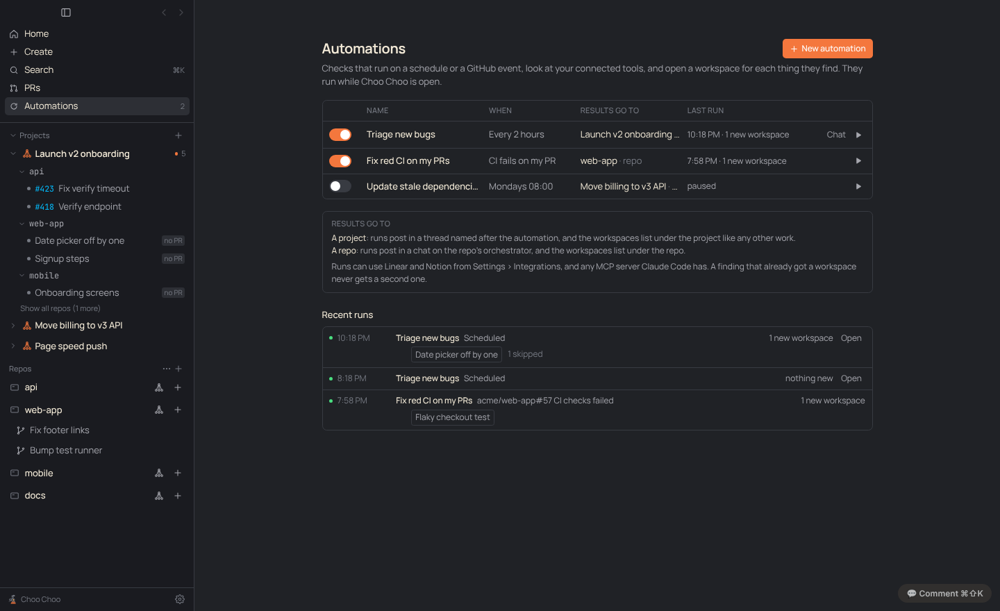
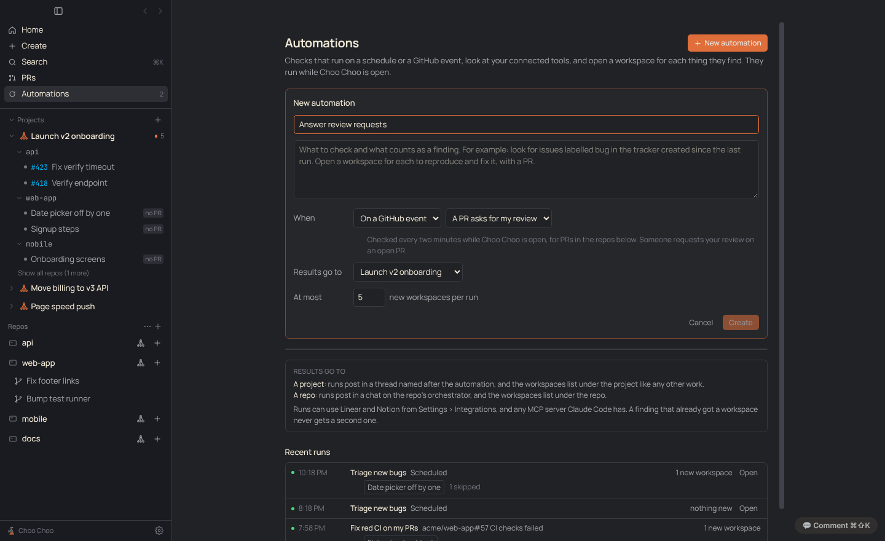
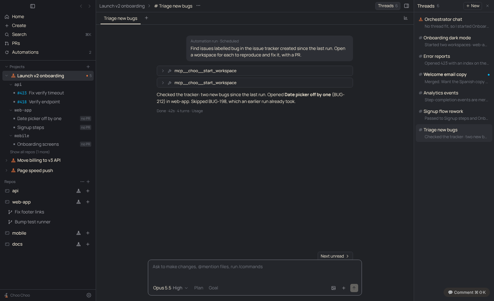

# PRD: Automations

| | |
|---|---|
| Status | Shipped behind Settings › Experimental › Projects (PR #80); new issue and new PR triggers in review |
| Requested by | Ben, 2026-11-10 |
| Last updated | 2026-11-10 |

## Problem

Some work starts the same way every time: a new bug lands in the tracker, CI goes red on your PR, someone asks for your review. Today a person has to notice it, open the orchestrator and ask. Ben asked for checks that run by themselves against a connected tool and open a worktree per finding.

## Goals

- Write a check once (what to look at, what counts as a finding) and have it run on a schedule, on a GitHub event, or when you press Run now.
- Each finding gets its own workspace, like work the orchestrator starts by hand.
- Results land somewhere you already look: a project thread, or the repo.
- A finding never gets a second workspace, and one run can't open dozens of workspaces.

## Non-goals

- Runs while Choo Choo is closed. That needs cloud runs; see Future work.
- Instant webhooks from GitHub, Linear or Notion. Choo Choo has no server ([decision 0004](../decisions/0004-no-server-git-for-sharing.md)).
- A visual rule builder. The check is a prompt.

## User experience

- **Automations** sits in the top nav under PRs while Settings › Experimental › Projects is on. The count is how many are on.
- The page lists each automation with an on/off switch, when it runs, where results go, and its last run. ▶ runs it now; Chat opens the conversation its runs post in.
- **New automation** opens an editor on the page: a name, what to check, when, where results go, and the most workspaces per run (default 5).

- **When**: every few hours, every day, weekdays, once a week (at a time), on a GitHub event, or only by hand.
- **GitHub events**: a PR asks for my review, a PR I'm reviewing changed for me (from [Review updates](review-updates.md): the PR's own code changed, someone answered your comment, or you were asked again; merges from main don't count; checked on the Settings › Reviews interval), CI fails on my PR, my PR gets a review (approved or changes requested), a new issue is opened, a new PR is opened. The last two take an optional label, so only items with that label count. Checked every two minutes while the app is open, only in the target's repos.
- **Results go to**:
  - a project: runs post in a thread named after the automation (it shows in the Threads panel), and their workspaces list under the project;
  - a repo: runs post in a chat on that repo's orchestrator, and their workspaces list under the repo.
- **Recent runs** lists the last runs with why each ran (Scheduled, Run now, `owner/repo#12 CI checks failed`), the workspaces it opened, and how many findings it skipped.

## Requirements

1. An automation has a name, a prompt, a trigger, a target (project or repo), a cap per run, and an on/off switch.
2. Schedules use local time. A run missed while the app was closed runs once when it opens, not once per missed slot.
3. A run that would start while the last one is still going is skipped and shows as skipped.
4. Each workspace a run opens is tied to a finding id. The app refuses a finding id the automation already handled, and refuses more than the cap in one run.
5. GitHub events fire only on change: turning on the first GitHub automation records where things stand and does not fire for PRs already open.
6. Runs can use whatever tools the orchestrator has: Linear and Notion from Settings › Integrations, Claude Code's own MCP servers, and add-on tools.
7. Deleting an automation keeps its chat, workspaces and run history.

## Design

- Data in `state.json` (`src/shared/types.ts` `AppState`): `automations`, `automationRuns` (last 300), `automationLedger` (finding ids per automation, last 1000), `githubWatch` (where the PR inbox stood at the last poll). Types and pure helpers in `src/shared/automations.ts`: `nextRun`, `diffInbox`, `runPrompt`, `describeTrigger`.
- `src/main/automations.ts` runs them: a 30 second tick for schedules, a two minute GitHub poll, and `runNow`. Events about the person's PRs reuse the PRs page query (`loadPrInbox`, `diffInbox`). New issues and PRs come from each target repo's newest 30 open issues (`gh.recentIssues`, `diffRepoItems`), remembering the highest number seen per repo in `githubWatch.latest`. A run is a turn in the automation's chat on an orchestrator, started with `runPrompt`.
- The chat: for a project, a thread on the project's orchestrator (`Chat.thread`, `Chat.automationId`); for a repo, a chat on the repo's orchestrator. The orchestrator is opened first so its own chat stays first.
- `orchestrator.queryOptions` takes `AutomationHooks` for turns in an automation's chat. `start_workspace` then requires `finding_id`, and `claim` (synchronous, so parallel calls can't both take the last slot) checks the ledger and the cap before the workspace is made. `start_workspace` is auto-allowed in these chats; the cap stands in for the person's OK.
- Workspaces a run opens get `automationId` and `threadId` (the run's chat), so automatic updates go back to that chat.
- IPC: `automation:save`, `automation:enable`, `automation:delete`, `automation:run`. UI: `src/renderer/src/components/Automations.tsx`.

## Compliance, privacy and security

- Runs are ordinary orchestrator turns through the Agent SDK and the person's own Claude Code sign-in ([decision 0001](../decisions/0001-official-claude-access-only.md)).
- Integrations keep signing in with OAuth ([decision 0003](../decisions/0003-oauth-for-integrations.md)); automations add no tokens.
- GitHub is read through the signed-in `gh` CLI, as on the PRs page. Nothing new leaves the machine.
- A run's other tool calls still follow the chat's permission setting, so a run can stop and wait for an approval.

## Testing

`test/automations.test.ts`: schedules, GitHub event diffing, the run prompt, the cap and ledger, skip while running, repo filtering, new issues by label, and `start_workspace` with a finding id. Screenshots above are from the built app with seeded state.

## Rollout

Behind Settings › Experimental › Projects. With it off, the page is hidden and nothing runs.

## Open questions

- Should a project thread get one thread per run instead of one per automation? One per automation keeps the Threads panel short; runs read as a history in it.

## Future work

- Cloud runs and webhooks, so automations run with the app closed and fire instantly.
- A mark on sidebar rows opened by an automation.
