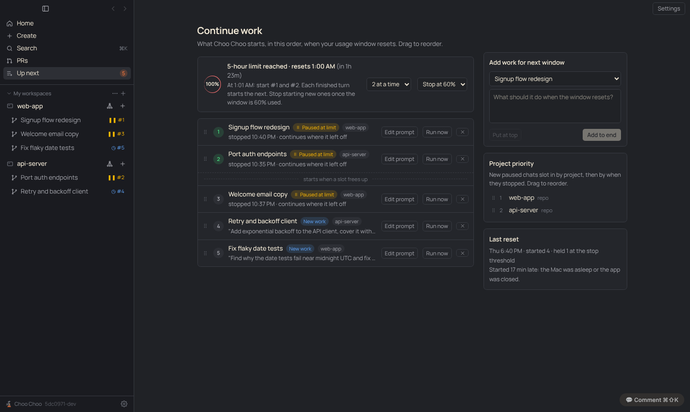
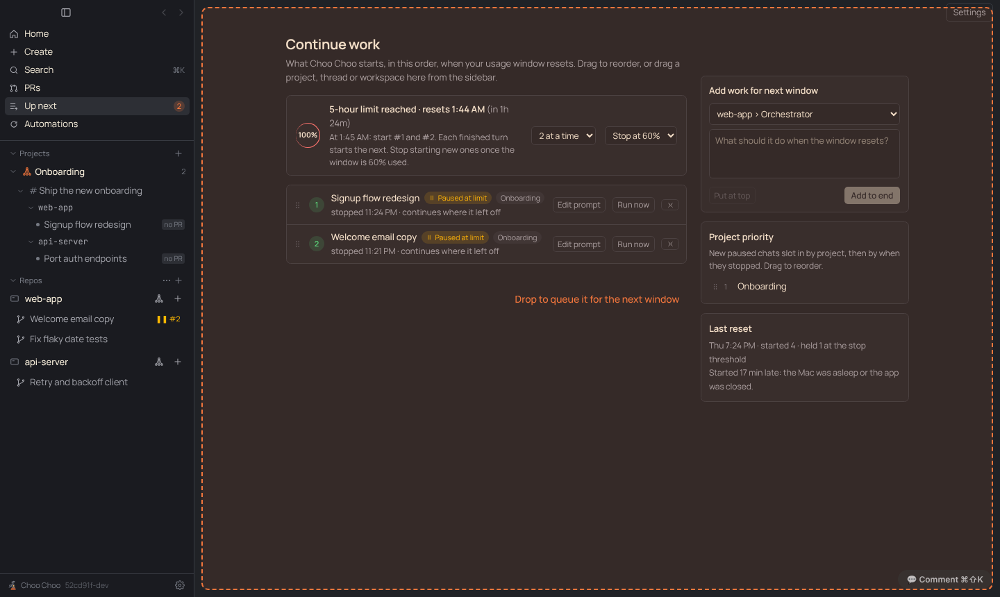
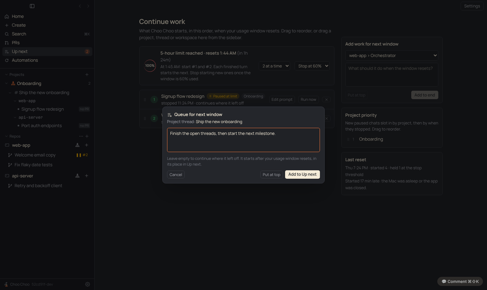
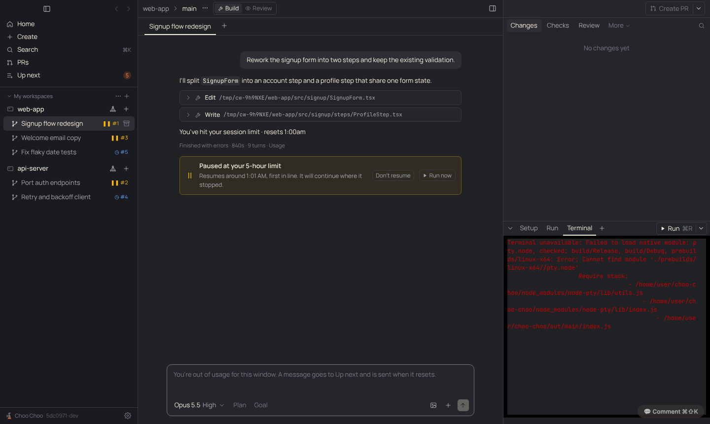

# PRD: Continue work (resume when the usage window resets)

| | |
|---|---|
| Status | Shipped |
| Owner | Claude |
| Requested by | Ben, 2026-11-12 |
| Last updated | 2026-11-13 |

## Problem

> Because of projects and the fan-out of worktrees, I've really easily consumed my five-hour window. I'm hoping there's some way to hook in and say: when my Claude subscription refreshes for the five-hour window, what should I continue working on? What sessions are prioritized and kicked off?

When a plan usage limit stops a chat, it sits there until a person notices the window has reset and types "continue". With a dozen workspaces stopped at once, the first person back also has to pick which to restart first, and restarting all of them burns the new window in minutes.

## Goals

- A chat that stops on the plan's usage limit says so, and says when it will continue.
- One ordered list, Up next, of what starts when the window resets: chats that stopped, and new work lined up for the next window.
- At reset, work starts in that order, a few at a time, and stops starting once the new window is partly used.
- It keeps working when the Mac slept or the app was closed at reset time.

## Non-goals

- Getting around a limit. Choo Choo never resumes before the reset time, never retries a refused window in a loop, and never switches accounts or keys.
- Runs while the Mac is off. That would need cloud sessions, which have their own limit handling.
- Codex chats. Codex has its own limits and resume flow; not paused or queued yet.
- Waiting for a weekly limit more than a day away (Claude Code doesn't either).

## Background

Claude Code already does this for one interactive session: the CLI's **Continue automatically at usage limit** setting (`autoContinueAtUsageLimit`, v2.1.234+) and the desktop app's **Auto-continue when limits reset** checkbox. Neither works in Agent SDK sessions, which is how Choo Choo runs chats, so Choo Choo does the waiting itself, across all its chats. See [decision 0019](../decisions/0019-resume-only-after-reset.md).

## User experience

- **A paused chat** shows a banner under its last message: "Paused at your 5-hour limit · Resumes around 3:48 PM, first in line", with Move to top, Don't resume and Run now. Its sidebar row shows ❚❚ #1. A message typed into any chat while out of usage is added to Up next instead of being sent into a refused turn.
- **Up next** (sidebar, under PRs) is the Continue work page: a status card (which limit, when it resets, what will happen), quick pickers for how many run at once and where to stop, and the ordered list. Drag to reorder. Each row can be edited (what it sends), run now, or removed. A dashed line marks which items start right away at reset and which wait for a free slot. On the right: add work for the next window (pick a chat, type what it should do), project priority (drag to order), and the last reset.
- **Home** shows a Continue work card with the first three items, only while the plan is out of usage for the current window (Ben, 2026-11-12). Otherwise Home is unchanged.
- **Drag from the sidebar onto Up next** (the sidebar row or the open page): a workspace, a project thread, or a project. Right-click any of them for **Queue for next window…** to do the same without dragging. A small dialog asks what it should do; leave it empty to continue where it left off. A workspace queues its current chat; a thread queues the thread; a project queues its orchestrator, which with no prompt is told to keep going on the project's open work. Put at top or Add to Up next. When the window resets, each one gets a new turn in its own chat, in order.

- **Sidebar footer**: under the plan limits, "❚❚ 2 paused · 3 up next at 3:48 PM" opens Up next.
- **Settings › Continue work**: resume paused chats (on), start at most (2 at a time), stop starting new work once the window is at (60%), order new paused chats by (project priority, then time), the continue prompt, wait for weekly limits under a day away (on), keep the Mac awake while work waits (off), notify when Up next starts (on).
- **Automations** gain a trigger, "When my usage window resets", which runs once per reset after Up next has started.

## Requirements

1. Detect a usage-limit stop from the SDK's `rate_limit_event` with `status: 'rejected'` (limit type and `resetsAt`), or, when that is missing, from Claude Code's limit message ("You've hit your session limit"). Spend-limit and seat messages don't count: waiting doesn't fix them. A turn paid by extra usage doesn't count.
2. A stopped chat gets `paused` (limit type, reset time, when). The app records that the plan is out of usage until the reset time. If the reset time is unknown, it reads `/usage`.
3. With resume on, a paused chat joins Up next: by project priority then time, or just by time. A chat that hits the limit again right after resuming goes back to the front, at most twice in a row.
4. Nothing starts before reset time + 1 minute. Then `/usage` must show the window below 100%; if not, wait for the reset time it reports, or check again in 5 minutes.
5. Up next starts items in order, one turn per chat, up to the "at a time" cap. The next one starts when a turn ends. Nothing new starts once the 5-hour window reaches the stop threshold. Run now ignores all of this.
6. When not at a limit, items still start, under the same cap and threshold.
7. Paused chats resume with the continue prompt; queued work sends its own text, in the same chat (same Claude session).
8. The check runs every 30 seconds, when a turn ends, when the Mac wakes, and on launch. Late starts (asleep or closed at reset) are noted in the reset log.
9. Keep Mac awake holds a `prevent-app-suspension` power-save blocker only while out of usage with items waiting.
10. Workspaces, project threads and projects can be dragged from the sidebar onto Up next, or queued from their right-click menu. A workspace resolves to its active chat (else its newest non-review chat), a thread to its chat, a project to its orchestrator chat (opened if needed). An empty prompt sends "continue where you left off" (the Settings continue prompt for a paused chat; for a project, "keep going on the project's open work").

## Design

- Types and pure helpers: `src/shared/continueWork.ts` (`limitFromEvent`, `limitFromText`, `shouldWait`, `insertIndex`, `pickToStart`, settings defaults).
- Detection: `src/main/agent.ts` sets `Chat.paused` at the end of a turn that stopped on a limit.
- Scheduler: `src/main/continueWork.ts`. State in `state.json`: `continueQueue`, `usageLimit`, `resetLog` (last 20). Settings in `settings.continueWork`.
- Wiring in `src/main/index.ts`: `onChatDone` → `continueWork.onTurnDone`; messages typed while limited go to the queue; `powerMonitor` resume; IPC `continue:add|move|edit|remove|run`.
- UI: `src/renderer/src/components/ContinueWork.tsx` (page, Home card, banner, Settings section), sidebar nav and row badges, footer line.
- Automations: trigger `{ kind: 'usage_reset' }`, fired by `automations.onUsageReset()`.
- Tests: `test/continueWork.test.ts`.

## Compliance, privacy and security

- Uses only the official Agent SDK and Claude Code binary with the person's own sign-in ([decision 0001](../decisions/0001-official-claude-access-only.md)). The signals are ones the SDK documents; usage comes from Claude Code's own `/usage`.
- Resumes only after the server's reset time and after `/usage` confirms the window is open ([decision 0019](../decisions/0019-resume-only-after-reset.md)). It matches what Claude Code's own auto-continue does.
- Nothing leaves the machine.

## Open questions

- Verify on a real limit hit that `resetsAt` arrives in seconds (the code accepts both) and that the `rejected` event comes before the failed result.
- Codex chats: pause on `usage_limit_exceeded` using the "try again at" time `codexCaps` already parses.
