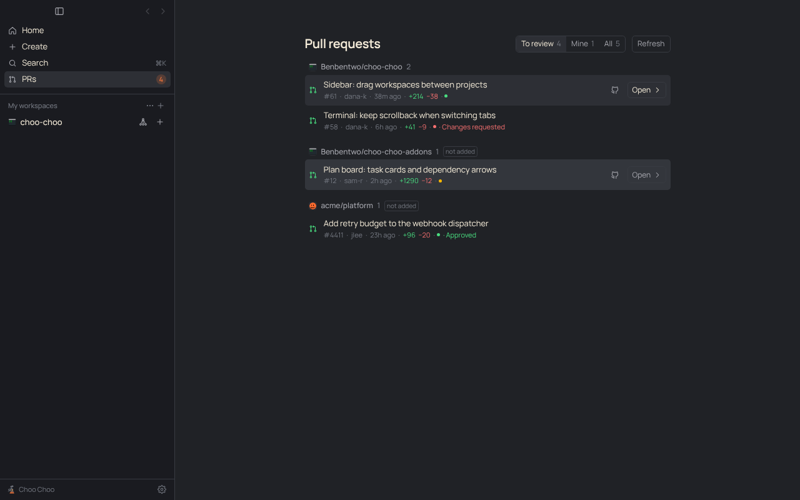

# PRD: PRs page

| | |
|---|---|
| Status | Shipped |
| Owner | Choo Choo maintainers |
| Requested by | Ben, 2026-11-09 |
| Last updated | 2026-11-12 |

## Problem

Ben: "Arc has a live folder PR review, a live folder of GitHub PRs that either you created or you need to review. Under the top left where there's Home, Create, and Search, maybe we can do a PRs section. It lists, when you click it, it shows on your homepage section, it kind of shows all the different PRs organized by repository that you're requested to review. You can click on one and there's an arrow button to open a workspace for it, where it'll open it up. Then you can use the Review button to start reviewing it."

Today, reviewing someone's PR means finding it on GitHub, then starting a workspace from the PR in the new-workspace composer, one repo at a time.

## Goals

- One place that lists every open PR waiting on your review, across all your repos, grouped by repo.
- One click from a PR to a workspace checked out on its branch, with the Review tab open.
- Your own open PRs in the same place, like Arc's live folder.

## Non-goals

- Reviewing on GitHub from the app (approve, request changes). The Review tab's findings and the PR page cover that.
- Notifications for new review requests. The sidebar count is the signal for now. PRs you already reviewed notify when they change for you ([Review updates](review-updates.md)).
- GitHub Enterprise hosts other than the one gh is signed in to.

## User experience

- The sidebar's top list has **PRs** under Search, with a count of PRs waiting on your review.
- Clicking it shows the PRs page in the center. Filters: **To review** (default), **Mine**, **All**, each with a count. The choice is remembered.
- **To review** also lists open PRs you already reviewed, since GitHub drops the request once you review. Those carry review updates: bold with a dot and reasons when they changed for you, a grey line when an update didn't matter, and an **Updated for you** filter ([Review updates](review-updates.md)).
- PRs are grouped by repo; repos are ordered by their most recently updated PR. Each row shows title, number, author, last update, lines added and removed, a checks dot (green, red, amber), Approved or Changes requested, and Draft.
- Click selects a row (arrow keys move, Enter opens). The **Open →** button opens a workspace on the PR's branch and switches the right panel to **Review**, where Start review runs the reviewer. Double-click does the same. The GitHub icon opens the PR in the browser.
- If a workspace is already on that branch, the row says "workspace open" and the button reads **Go →**.
- If the repo isn't a project yet, its header says "not added"; Open clones it (through gh, into the usual repos folder), adds it, then opens the workspace.
- The list reloads every minute while the page is open, when the window gets focus, and with Refresh. The sidebar count reloads every five minutes in the background.
- Errors: no gh, or gh not signed in, shows a line saying what to run (`brew install gh`, `gh auth login`).
- **Filter** lists each org and its repos with counts and tick boxes. Unticking an org or repo hides its PRs from the page and from the sidebar count. The choice is saved in Settings on this computer only (`prsHidden`), so a work laptop can leave out personal repos. The button shows how many are hidden; Show everything clears it.
- The last good list is saved and shown at once on start-up. When a refresh fails, the page keeps that list and says when it was loaded.
- The two lists load as separate searches of 50 PRs each, newest first (20 if GitHub times out). One query for both, 100 each with CI status, made GitHub answer HTTP 502.

## Requirements

1. List open PRs where review is requested from you (directly or through a team) and open PRs you authored, excluding archived repos.
2. Group by `owner/repo`; each PR appears once even when it matches both searches.
3. Match each PR's repo to a local project by its origin remote, and to an open workspace by branch (`pr-N` for forks).
4. Opening reuses the workspace when there is one; otherwise clones if needed, creates the workspace from the PR, and opens the Review tab.
5. Use the person's existing gh sign-in; no new tokens.

## Design

- `src/shared/prInbox.ts`: the GraphQL query (two aliased `search` calls), `parsePrInbox`, `groupByRepo`, `prBranch`.
- `src/main/github.ts` `prInbox()` runs `gh api graphql`. `src/main/index.ts` `loadPrInbox()` adds `repoId` and `workspaceId`; IPC `prs:inbox`, `Api.prInbox()`.
- Renderer: `store.ts` holds `prsPage`, `prInbox`, `refreshPrInbox()` and `openPrWorkspace()`; `components/PrInbox.tsx` is the page; `Sidebar.tsx` adds the nav item; `App.tsx` routes to the page and starts the background refresh.
- Workspaces are created with the existing `{ kind: 'pr' }` source, so fork PRs check out as `pr-N` like they already do.

## Compliance, privacy and security

- No Claude access involved.
- GitHub access is the gh CLI's existing sign-in. Nothing new is stored. Requests go only to GitHub.

## Testing

`test/pr-inbox.test.ts` covers parsing, de-duplication, grouping, filtering and branch names. Checked in the built app under xvfb with a stub gh: listing, filters, opening a workspace on the Review tab, and the "workspace open" state.

## Rollout

On for everyone. No settings or migration.

## Future work

- A notification when a new review request arrives.
- Showing PRs from repos on other GitHub hosts gh is signed in to.
