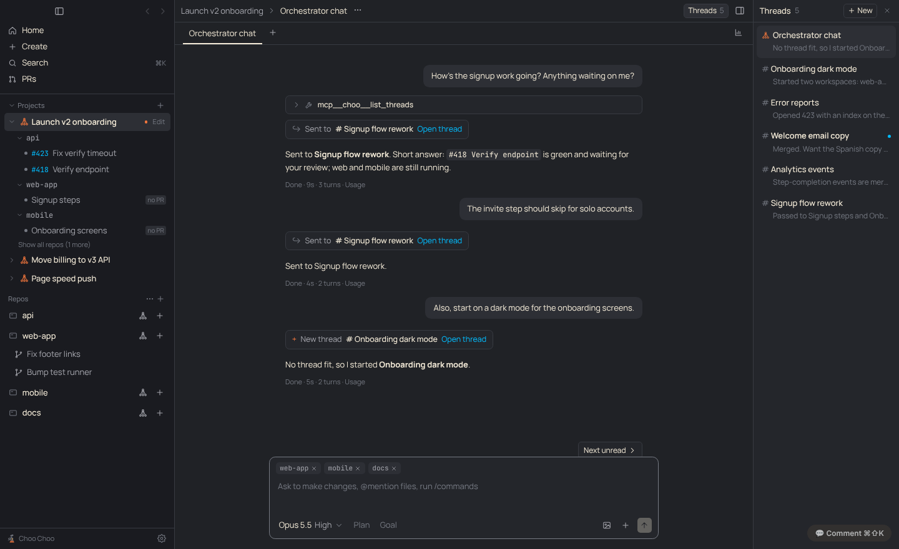
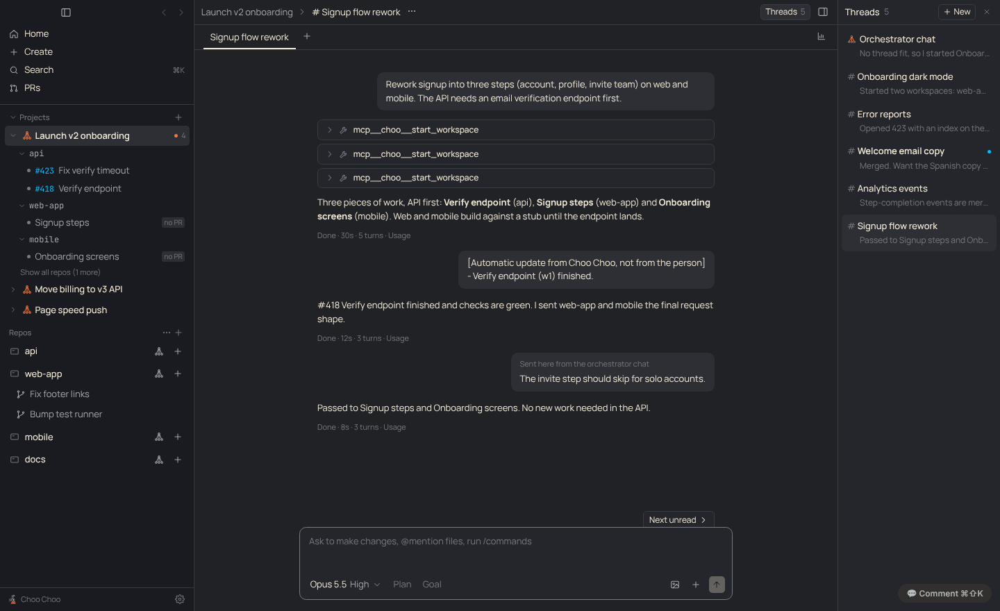
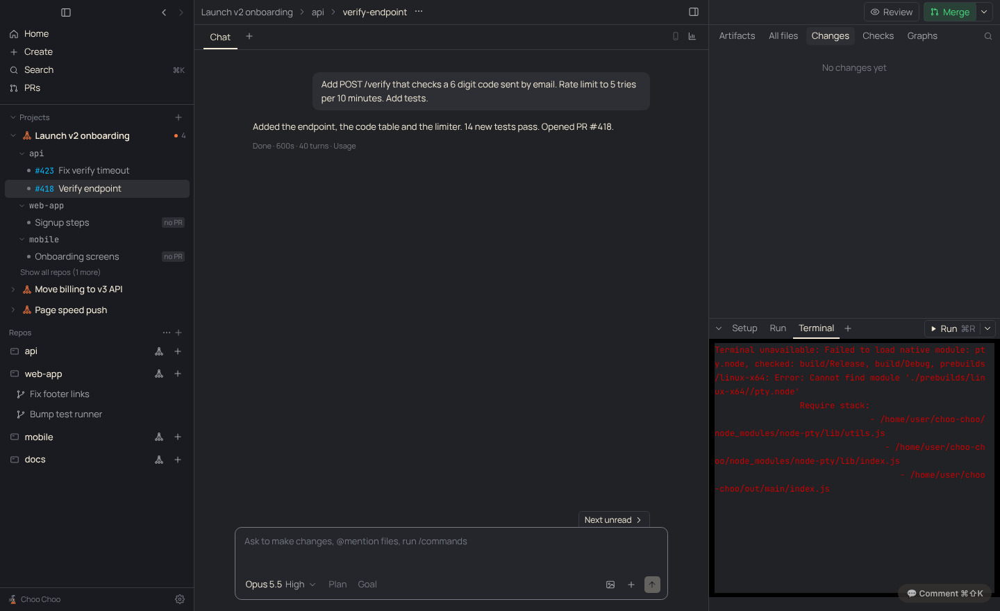

# PRD: Projects

| | |
|---|---|
| Status | In progress: projects and threads behind Settings › Experimental (this PR). Automations not started |
| Requested by | Ben, 2026-11-10 |
| Last updated | 2026-11-10 |

## Problem

Big pieces of work, such as a milestone or a change across several repos, need more than one conversation. Project groups ([orchestrator PRD](orchestrator.md)) give several repos one orchestrator, but everything happens in a single chat, and the workspaces it starts are mixed in with everything else in the sidebar. Ben wanted something like Claude desktop's projects: one project per big idea, conversations kept apart by topic, and the work underneath it.

## Goals

- One project per goal, over one or more repos.
- You mostly talk to the project's orchestrator chat. It sends each message to the thread it belongs to, or starts a new thread.
- Threads work like Claude desktop project threads: separate conversations, listed in a panel on the right, opened full size.
- The sidebar shows the work: project › repos with open work › one row per workspace, named by its PR once there is one. Clicking a row opens that worktree and its Claude session.
- Everything folds: the Projects section, each project, each repo inside a project.

## Non-goals

- Automations (scheduled checks that open a workspace per finding). Ben wants to review where they live first.
- Slack-style replies hanging off a message. Threads are whole conversations.
- Tying a workspace to a thread in the sidebar. Workspaces belong to the project; the thread only gets its updates.

## User experience

Settings › Experimental › Projects turns it on. Project groups become projects; nothing is migrated or deleted, and turning it off brings back the old Project groups list.

- **Sidebar:** a Projects section above the repos. Each project folds. Under it, only repos with open work (Show all repos lists the rest), and under each repo the project's workspaces: `#418 Verify endpoint` once a PR exists, else the workspace's name with a "no PR" tag. Workspaces that belong to a project leave the plain repo list below.
- **Orchestrator chat:** clicking the project opens it. Each message is forwarded to a thread ("Sent to # Signup flow rework", Open thread) or starts one ("New thread # Onboarding dark mode"). Quick status questions are answered there.
- **Threads:** the Threads button in the header opens the list on the right: the orchestrator chat first, then threads, newest first, each with its last line. New starts an empty thread; it takes its title from its first message. Clicking one opens it in place of the orchestrator chat.

- **Updates:** when a workspace finishes, the automatic update goes to the thread that started it, or to the orchestrator chat if that thread is gone.
- **A project's workspace** shows the project's name before its repo in the header; clicking it goes back to the orchestrator chat.

## Requirements

1. Off by default (`Settings.experimentalProjects`). Off, everything behaves as before.
2. A project is a `RepoGroup`. Its orchestrator workspace's first non-thread chat is the orchestrator chat; every chat with `thread: true` is a thread.
3. The orchestrator chat has `list_threads` and `send_to_thread` and no `start_workspace`. It forwards the person's message in full, marked with `[Sent here from the orchestrator chat]`, then replies in one line.
4. A forwarded message is sent like a message the person typed: steered or queued if the thread is busy.
5. Threads have the full orchestrator tool set. A workspace started in a thread records `threadId`; its updates go to that thread.
6. Every thread shares the project's memory and can see every workspace in the project.
7. New chat on a project orchestrator makes a thread. A thread named "New thread" takes its title from its first message.
8. The sidebar tree lists open workspaces with `orchestratorId` equal to the project, by repo, newest first. PR numbers come from `getPr`, cached per workspace until the PR watcher reports a change.
9. Fold state lives in `Settings.sidebarCollapsed` with keys `section:projects`, `project:<id>` and `project:<id>:<repoId>`.

## Design

- `src/shared/projects.ts`: pure helpers (router chat, threads, update target, sidebar tree, thread titles, fold keys). Tested in `test/projects.test.ts`.
- `src/main/orchestrator.ts`: `ProjectRole` (router or thread, with list/create/forward). `queryOptions` and `systemPrompt` take it; the router gets `routerTools`.
- `src/main/index.ts`: `projectRole()` picks the role per chat, `newThread()` makes threads (also from `chat:create`), `noteForOrchestrator` uses `updateTarget`.
- Renderer: `components/Projects.tsx` (sidebar section, PR rows, Threads panel, route chip), `Center.tsx` (Threads button, one chat at a time), `ChatView.tsx` (route chip, forwarded-message label), Settings › Experimental.

## Compliance, privacy and security

Runs on the Agent SDK with the person's own sign-in like every chat ([decision 0001](../decisions/0001-official-claude-access-only.md)). No new services or sign-ins.

## Testing

`test/projects.test.ts`, `test/orchestrator.test.ts` (project threads). Screenshots above are from the built app with a seeded state and a stand-in `gh`.

## Future work

- Automations: where they live is open (Ben, 2026-11-10).
- Thread and project views as split-panel panes.
- Rename "project group" everywhere once the flag is on by default.
