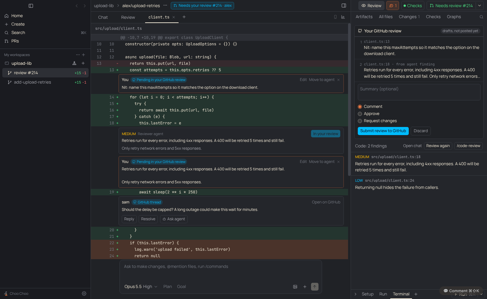

# PRD: Line comments go to the agent or a GitHub review

| | |
|---|---|
| Status | In review |
| Owner | Claude |
| Requested by | Ben, 2026-11-10 |
| Last updated | 2026-11-10 |

## Problem

> when I comment on a line, we need to figure out whether I want to send this context to an agent or whether I want to start a review and directly comment on the code.

Line comments in the diff could only go to the agent. That fits reviewing what your own agents wrote, but not reviewing a coworker's PR: there the person wants their comments to land on GitHub as a review, and sometimes still wants to ask an agent about a line.

Three cases:

1. Reviewing code your agents wrote, and sending comments back to them.
2. Reviewing someone else's PR in a workspace, and posting a GitHub review.
3. Reviewing someone else's PR, but asking an agent about some lines.

## Goals

- Every line comment has a destination, Agent or GitHub review, with a sensible default and one key to pick the other.
- A GitHub review is built up as drafts and posted in one go, with a summary and Comment, Approve or Request changes.
- Reviewer-agent findings can become comments in your review.
- Other reviewers' threads show in the diff, with Reply, Resolve and Ask agent.
- The header says whose PR the workspace is on.

## Non-goals

- Syncing with a pending review started on github.com. Drafts live in the app until submitted.
- Editing or deleting comments after they're posted.
- Suggested-change blocks written for you. The agent can draft one when asked.

## User experience

- **Default destination.** In Review mode on an open PR, comments go to your GitHub review; in Build mode they go to the agent. The mode starts as Review on someone else's open PR and can be switched in the header ([Build and Review modes](workspace-modes.md)).
- **Comment box.** Click or drag line numbers as before. The box has a "Send to: GitHub review | Agent" switch. ⌘↵ sends to the chosen one; ⌘⇧↵ sends to the other. The hint on the right says why the default was picked.
- **Drafts in the diff.** A saved comment shows on its line tagged "Pending in your GitHub review" or "Queued for the agent", with Edit, Move to the other destination, and remove.
- **Review tab.** "Your GitHub review" lists the drafts, takes an optional summary and Comment, Approve or Request changes (Approve and Request changes only on someone else's PR), and has Submit review to GitHub and Discard. After posting it shows "Review posted to GitHub" with a link. "Queued for the agent" lists agent comments with Send to agent; the chat box sends them too.
- **Agent on someone else's PR.** Agent comments and Ask agent tell the agent not to commit or push, and to answer or draft a GitHub suggestion instead.
- **Agent findings.** Each finding in the diff has "Add to my review" (someone else's PR) or "Add to GitHub review" and Fix (your own). Adding copies it into your review as a draft you can edit.
- **GitHub threads.** Unresolved threads show on their line: Reply posts on GitHub, Resolve resolves the thread, Ask agent sends the thread to the agent.
- **Header.** A pill next to the branch says "Needs your review #214 · alex", "You approved #214 · alex", or "Your PR #212". Clicking it opens the Review tab.
- **Lines GitHub won't take.** A comment can only go to GitHub when its lines are in the PR's diff, the worktree is on the PR's head commit, and the file has no uncommitted changes. Otherwise the GitHub option is off and says why, and drafts that no longer fit are marked before submit.

## Requirements

1. Ownership is the PR author compared with the signed-in gh user (`viewer`), ignoring case.
2. Drafts are kept per workspace in `localStorage` so a half-written review survives a restart.
3. Submit posts one review with all drafts through `POST /repos/{owner}/{repo}/pulls/{n}/reviews`, pinned to the PR's head commit. Nothing is posted before submit.
4. Multi-line comments use `start_line`/`line`; removed lines use side `LEFT`.
5. Reviewer text sent to the agent is fenced and escaped, as in "Add all comments to chat".

## Design

- `src/shared/prReview.ts`: ownership (`isTheirs`, `defaultMode`, `modeDest`, `prOwnerLabel`), `patchLines`, `draftProblem`, `reviewPayload`, `threadPrompt`.
- `src/shared/prComments.ts`: the feedback query also asks for `viewer`, thread ids and sides; `parsePrReviewInfo` adds author, viewer and the viewer's last review.
- `src/main/github.ts`: `prReview`, `prDiffLines` (PR files API), `submitReview` (gh api with the body on stdin), `replyToThread`, `resolveThread`. IPC `pr:review`, `pr:diffTarget`, `pr:submitReview`, `pr:replyThread`, `pr:resolveThread`.
- Renderer: `CodeComment.dest` in the store; `prReview` per workspace, loaded by the PR button and `usePrReview`; `DiffView.tsx` comment box, drafts and threads; `ReviewDrafts.tsx` at the top of the Review tab; `PrOwnerPill` in `Center.tsx`.

## Compliance, privacy and security

- No Claude access changes.
- GitHub calls go through the person's `gh` sign-in. Reviews and replies post as them, only when they press Submit or Reply.

## Testing

`test/pr-review.test.ts` covers ownership, labels, patch line parsing, the draft checks, the review payload and the thread prompt. Checked in the built app against a stand-in `gh`: drafts, finding to review, and the posted payload.

## Rollout

On for everyone. Old queued comments have no destination and count as agent comments.

## Future work

- Show threads on outdated lines in place, not only at the top of the file.
- Turn an agent's suggestion block into a draft in one click.
