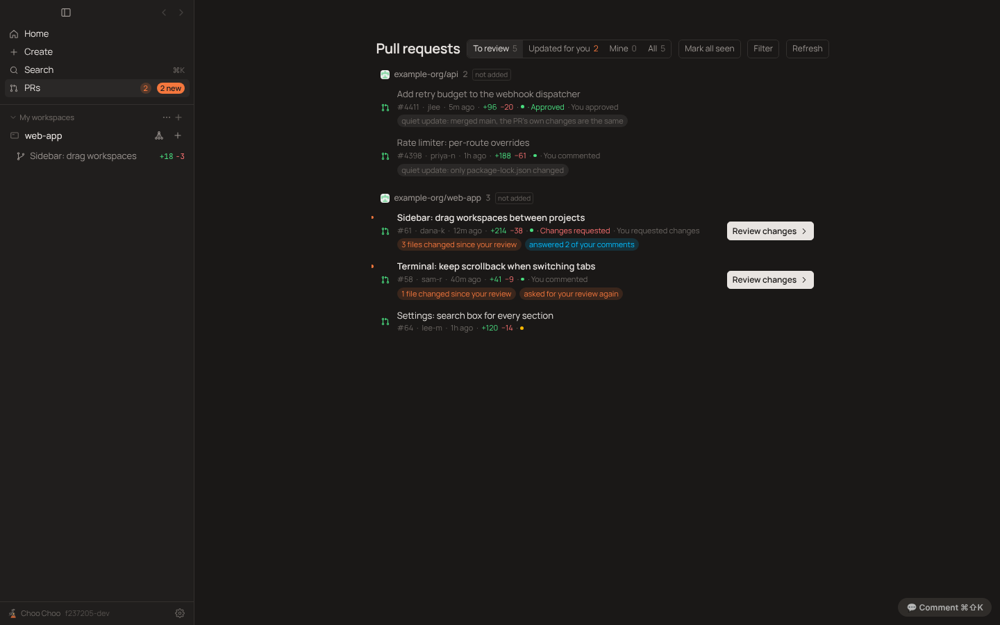
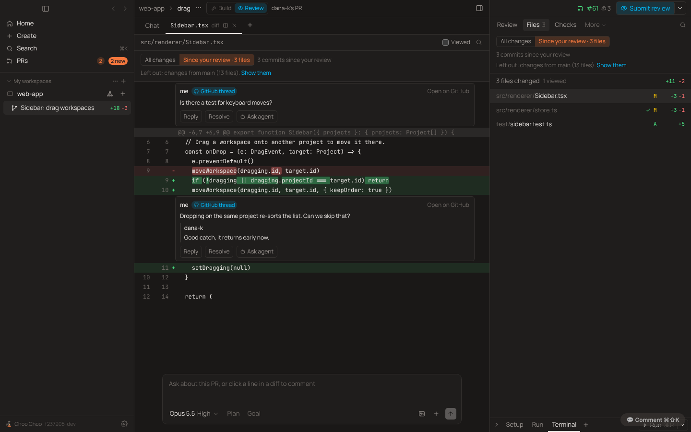
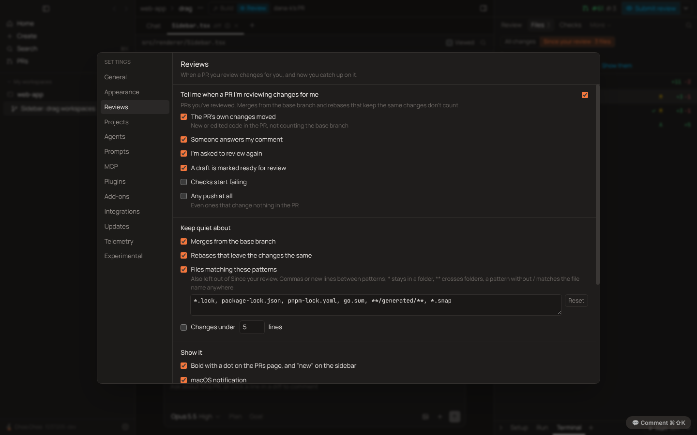

# PRD: Review updates

| | |
|---|---|
| Status | In progress |
| Owner | Choo Choo maintainers |
| Requested by | Ben, 2026-11-12 |
| Last updated | 2026-11-12 |

## Problem

GitHub tells a reviewer every time a PR they review is updated, including when the author only merged the base branch in or rebased. On a busy repo that is most updates, so people stop reading the notifications. Coming back to the PR is noisy too: "changes since your last review" on GitHub, and choo-choo's own list until now, include every file the base branch brought in.

Ben: "He's hoping for something where he gets notified when there's a difference or a change made that is important to him, the reviewer. And when he goes back to review the PR, it only shows really what's changed."

## Goals

- Tell a reviewer when a PR they review changed in a way that matters to them, and stay quiet otherwise.
- Coming back to a PR, show only what the author changed since your last review, with one click back to everything.
- Each rule can be turned off, and the list of ignored files is yours to edit.

## Non-goals

- Real GitHub webhooks. A desktop app has no public URL for GitHub to call, and each repo would need an admin to add the hook. Polling through the gh sign-in gets the same result.
- Notifications about your own PRs. Those need their own design (Ben, 2026-11-12).
- Notifications while choo-choo isn't running.

## User experience

**What counts.** When a PR you reviewed moves, choo-choo works out the interdiff: the PR's own changes now against its own changes at your last review. A merge from the base branch, GitHub's Update branch, or a rebase that keeps the same changes comes out empty and stays quiet. These count, each with its own switch in Settings › Reviews:

- The PR's own changes moved (on).
- Someone answered a thread you started (on).
- You were asked to review again after you reviewed (on).
- A draft was marked ready for review (on).
- Checks started failing (off).
- Any push at all (off).

Keep quiet about: merges from the base branch (on), rebases that leave the changes the same (on), files matching an editable list of globs (on; lockfiles, `**/generated/**`, snapshots), and changes under N lines (off, N = 5).

**PRs page.** The To review list now also has the open PRs you already reviewed (GitHub drops them from "review requested" once you review). A PR that changed for you is bold with an orange dot and says why: "3 files changed since your review", "answered 2 of your comments", "asked for your review again", "ready for review". A quiet update says what happened in grey: "quiet update: merged main, the PR's own changes are the same". A new **Updated for you** filter lists only those; the sidebar's PRs row shows "2 new". The row's button reads **Review changes**. Opening the PR, or **Mark all seen**, clears the mark.

**Notifications.** One macOS notification per PR that changed for you, naming who and why. Clicking it opens the PR in a workspace on the Review tab with Since your review on. Optional quiet hours.

**When it checks.** Every 2 minutes by default; 1, 2 and 5 minutes are offered and any number of minutes from 1 to 120 can be typed. It also checks when you open the PRs page, when you open a workspace on a PR you review, and when the window comes to the front.

**Since your review** (its own toggle).

On someone else's PR in Review mode, once you've reviewed and the author pushed, the Files list and the diff get **All changes | Since your review · N files**. Since your review lists only the files the author changed and shows only those hunks, with a line saying what was left out ("Left out: changes from main (41 files) and package-lock.json") and **Show them**. The choice is remembered per workspace; Settings › Reviews › "Open reviewed PRs on Since your review" sets the default (on). Removed lines in this view are against your last review, not the PR, so commenting on them asks you to switch to All changes. The Review tab's "Since your review" card uses the same interdiff.

**Automations.** A new GitHub event, "A PR I'm reviewing changed for me", starts an automation with the PR and the reasons, so an agent can summarise the new changes before you look.

**Viewed files.** With "Sync viewed ticks with GitHub" on, each file in the diff has a Viewed tick that is GitHub's own per-file viewed state. GitHub clears it when the file changes.

## Requirements

1. The interdiff leaves out everything that came from the base branch: merges from it, a new base after a rebase, and Update branch.
2. A file whose old changes clash with the new base falls back to the plain diff for that file, and the view says so.
3. Classification works without a local clone (GitHub's compare API, per-file patches compared with line numbers stripped), and uses the local repo for the diff view.
4. One GitHub search per list per poll; details only for PRs whose `updatedAt` moved.
5. Each notification reason and each quiet rule has a switch; the ignore list is editable; the interval accepts a custom value.
6. Uses the existing gh sign-in. Nothing new is stored on GitHub.

## Design

- `src/shared/reviewUpdates.ts`: `ReviewSettings` and defaults, glob matching, `comparePatches` (API path), labels.
- `src/main/interdiff.ts`: replays the PR's old changes onto its new base in a throwaway index (`git apply --cached`, `git write-tree`; works with any git) and diffs that tree against the new head. IPC `pr:interdiff`, `pr:interdiffFile`.
- `src/renderer/src/sinceReview.ts` (`useSinceReview`) and `components/SinceReview.tsx` (the toggle), used by the Files list (`RightPanel.tsx`), `DiffView.tsx` and `ReviewFollowUp.tsx`.
- `src/main/reviewWatch.ts` and `src/shared/reviewWatch.ts`: the poll, per-PR state (last head seen, your review commit, reasons, seen), classification and notifications. The inbox query (`src/shared/prInbox.ts`) gains a third search, `reviewed-by:@me`, plus `headRefOid` and `baseRefName`.
- Settings › Reviews (`Modals.tsx`), `Settings.reviews`.

## Compliance, privacy and security

- No Claude access involved. Automations started by the new event run like other automations.
- GitHub access is the gh CLI's existing sign-in. Requests go only to GitHub. Per-PR state stays in the app's local state file.

## Testing

`test/interdiff.test.ts` builds real repos: merge from main, clean rebase, author change after a merge in the same file, ignored files, a clash with the new base, missing commits; plus patch comparison and globs. `test/review-watch.test.ts` covers classification, reasons and notification decisions. Checked in the built app under xvfb with a stand-in gh.

## Rollout

On by default. Settings live in `Settings.reviews` and are filled in by `normalizeReviewSettings`, so older saves need no migration.

## Future work

- Notifications for your own PRs (new reviews and comments).
- A menu-bar mode that keeps checking when the window is closed.
