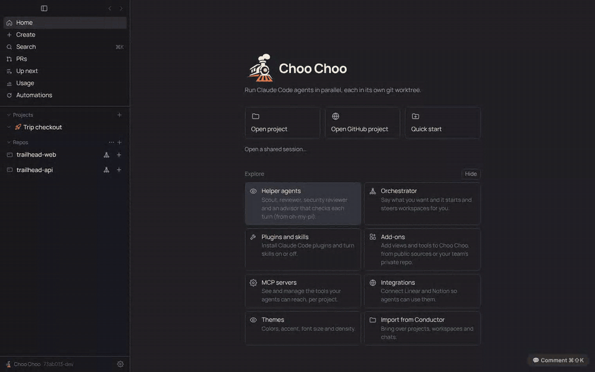

# PRD: Settings search

| | |
|---|---|
| Status | In review (PR #118) |
| Owner | Choo Choo maintainers |
| Requested by | Ben, 2026-11-13 |
| Last updated | 2026-11-13 |

## Problem

Settings has fifteen sections and close to a hundred settings. Finding one means remembering which section it lives in ("is notifications under General or Reviews?"). Ben asked: "Let's add search for settings."

## Goals

- Type a few letters and see every matching setting, from every section, with its section name.
- One keystroke (Enter) or click takes you to the setting, scrolled into view and highlighted.
- Find settings by the words people use, not only the label ("dark mode" finds Theme, "budget" finds Spend cap per message).

## Non-goals

- Searching the contents of lists that load at runtime (installed plugins, MCP servers, add-ons, projects). Search finds those sections; their own search boxes find items.
- Changing a setting from the results list.

## User experience

- A search box sits at the top of the Settings section list, with a ⌘F hint. ⌘F anywhere in Settings focuses it (it doesn't open the find bar of a diff behind the window).
- While the box has text, the right side shows **Search results**: label (matching words marked), hint, and a chip naming the section. Rows shown only after another switch is on (for example Telemetry's Endpoint) say so. The section list shows a count beside each section with matches and dims the rest.
- ↑ ↓ move the highlight, Enter opens it, Esc clears the query (a second Esc closes Settings as before). Clicking a section clears the query and opens it.
- Opening a result switches to its section, scrolls the row into view and washes it in the accent color for about two seconds (held still with Reduce motion).
- No match: "No settings match “…”".

## Requirements

1. Every labelled setting is listed in `SETTINGS_INDEX` with its section, label, a hint and other words for it.
2. A query matches when every word matches the label, other words, hint or section name. Results rank label matches first.
3. Opening a result selects its section and scrolls to and highlights the row; if the row isn't drawn (it needs another switch on) the section opens at the top.
4. ⌘F in Settings focuses search; Esc clears a query before it closes Settings.
5. A test fails when a settings component draws a label that `SETTINGS_INDEX` doesn't list, so new settings are searchable when they ship.

## Design

- `src/renderer/src/settingsSearch.ts`: `SETTINGS_INDEX`, `searchSettings(query, sectionLabels)`, `matchCounts`, and `findSettingRow(container, label)`, which finds the text node equal to the label and widens it to its `<label>` or bordered row.
- `SettingsModal` in `src/renderer/src/components/Modals.tsx` holds the query, draws results in place of the section body, and after opening a result looks for the row for up to a second (some sections load their rows a moment after they open). The flash is the `settings-flash` class in `styles.css`.
- Nothing is stored and nothing leaves the machine.

## Compliance, privacy and security

- No Claude access, no sign-in, no network, no stored data.

## Testing

`test/settingsSearch.test.ts`: ranking, all-words matching, other words, quotes and case, per-section counts, the index-coverage check over the settings components, and `findSettingRow` under jsdom. The README GIF scene `settings-search` in `scripts/demo/record.cjs` drives the real app.

## Rollout

On for everyone; no setting.

## Future work

- Search inside runtime lists (plugins, MCP servers, add-ons) from the same box.
