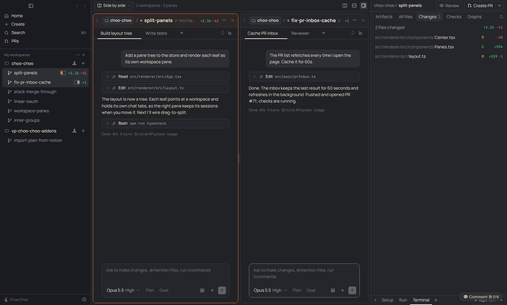
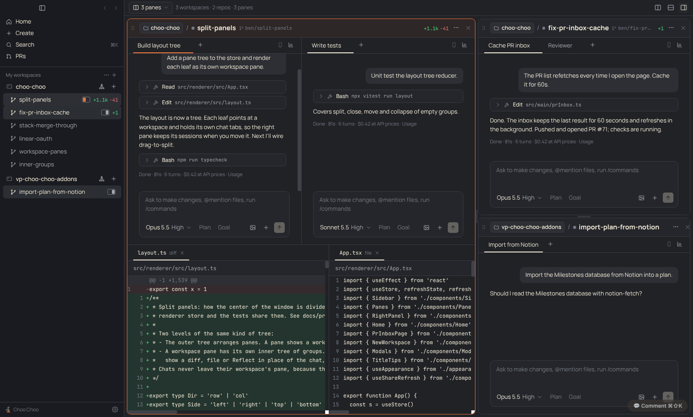
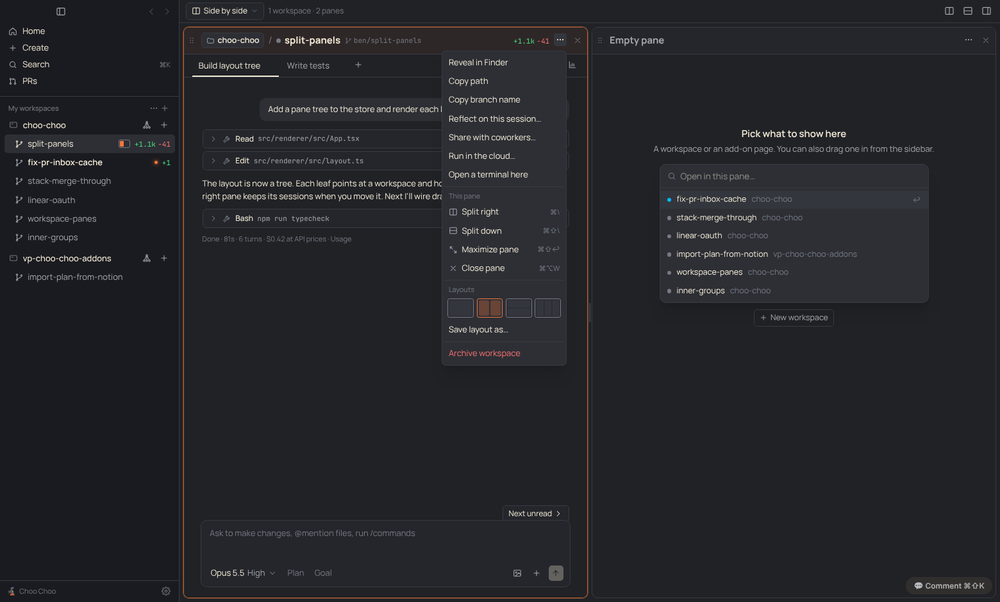
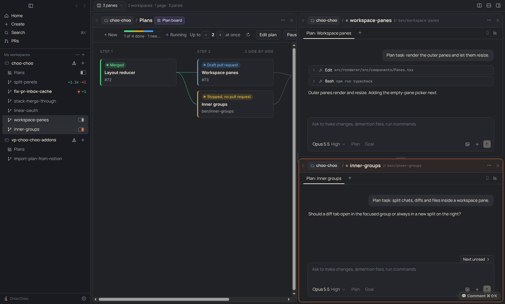

# PRD: Split panels

| | |
|---|---|
| Status | In review |
| Owner | Claude |
| Requested by | Ben, 2026-11-10 |
| Last updated | 2026-11-10 |

Mockups (project files `split-panels/`): `1-side-by-side.png`, `2-nested-splits.png`, `3-drag-to-split.png`, `4-pane-menu-and-picker.png`, `5-plan-board-pane.png` (source `mockup.html`, open with `#s1` … `#s5`).

Live app: 

## Problem

Choo Choo shows one workspace at a time and one chat at a time inside it. Ben asked for Orca-style split panels: "move panels around and organize your view of a work tree, as split or combined as you want", and also split different worktrees, "one work tree split on the left and one on the right, with all of its sub-sessions still nested in that pane".

How Orca does it ([docs](https://www.onorca.dev/docs/model/tabs-panes-splits)): each worktree has its own pane tree of tab groups (terminal, editor, browser, diff, PR). Drag a tab to a pane edge to split, onto another group to move. Pane sizes are saved per worktree, and switching worktrees swaps the whole tree. Orca does not document putting two worktrees side by side, which is the part Ben wants most, so we go one step further.

## Goals

- Two or more workspaces visible at once, each in its own frame with its own chat tabs, composer and status.
- Inside one workspace, split chats, diffs, files and terminals side by side or stacked.
- Rearrange by drag and drop, keyboard, or a pane menu. Resize by dragging dividers.
- Layout survives restart. Default stays exactly today's single view, so nobody is surprised.

## Non-goals

- Tearing panes out into separate OS windows (possible later).
- Moving a chat into a different workspace's frame. A chat runs in its worktree, so it stays in that workspace's frame.
- Per-pane right panels. There is one right panel; it follows the focused pane.

## User experience

**Two levels.** The outer layout arranges workspace panes (scene 1). Each workspace pane has a header that says plainly what's in it: the repo name in a boxed chip with a folder icon, a slash, then the workspace name in large bold type, then the branch in small mono, then diff stats or PR/check badge, ⋯ menu and close and inside it an inner layout of tab groups: chats, diff, file, Reflect, terminal (scene 2). Splits nest freely at both levels.

**Focus.** Clicking in a pane focuses it (orange outline). The right panel, ⌘T new chat, ⌘W close chat, the command palette's file search and add-on buttons act on the focused workspace. The sidebar marks each open workspace with a small left/right icon showing where it is.

**Opening things.**
- Click a sidebar workspace: opens it in the focused pane (today's behavior when there's one pane).
- ⌘-click, or "Open to the side" in the row's right-click menu: opens it in a new pane to the right.
- Drag a sidebar workspace onto the view (scene 3): edges split left/right/top/bottom, the middle replaces.
- Drag a chat tab to an edge of its own workspace frame: splits that chat out. Drop it in the middle of another group: moves it there.
- ⌘\ split right, ⌘⇧\ split down: the new pane is empty and shows a picker of workspaces and add-on pages (scene 4).

**Add-on pages as panes (scene 5).** App and project add-on pages (like the Plan board) open as panes instead of taking over the whole center. Their header shows the repo chip, the page name and a purple add-on chip. The Plan board's "Open workspace" opens that workspace beside the board, stacking up to three panes on the right and then reusing the last one. Add-on workspace views stay in the right panel and can also be dragged into that workspace's frame as a tab.

**Pane menu (⋯).** Split right, Split down, Maximize pane (⌘⇧↩, toggles), Merge chats into one pane (collapses the inner split back to tabs), Close pane (⌘⌥W). The workspace menu also has "Open a terminal here", which adds a terminal tab to the focused group. Layout presets (single, two columns, two rows, three columns) and "Save layout as…".

**Layouts.** The title bar pill shows the current layout name ("Single", "Side by side", or a saved name) and switches between saved layouts. Saved layouts store which workspaces are where; an archived workspace's pane closes.

**Moving focus.** ⌘⌥←/→/↑/↓ moves focus between panes. ⌘1…⌘9 keeps selecting sidebar workspaces into the focused pane.

**Small sizes.** Dragging a divider stops at a minimum of 340px per pane (220px for groups inside a pane). Headers shrink the branch first, so the repo and workspace names stay readable.

**Closing.** Closing the last pane of the view returns to Home. Closing a pane never archives the workspace or stops its agents; it just stops showing it.

## Requirements

1. Layout is a tree: `split` nodes (row or column, child sizes as fractions) and `workspace` leaves. Each workspace leaf holds an inner tree of `split` nodes and `group` leaves; a group has ordered tabs and an active tab.
2. A tab is a chat, a diff/file doc, Reflect, or a terminal of that workspace.
3. Exactly one focused pane and one focused group at all times while any pane is open.
4. One workspace can appear in only one pane at a time. Opening it again focuses the existing pane.
5. Each chat appears in only one group. New chats open in the focused group.
6. Drag and drop: sidebar workspace → view, chat tab → its own workspace frame, pane header grip → view (moves the whole workspace pane). Drop targets highlight; invalid drops (chat into another workspace) show no target.
7. Dividers resize with the mouse; double-click resets to equal sizes.
8. Layout, sizes, focus and saved layouts persist in settings and survive restart. Missing or archived workspaces are dropped on load.
9. Single-pane view looks and behaves exactly like today. The pane frame and outline only appear once there are two or more panes.
10. Running and unread dots, permission prompts and "Next unread" work per pane; "Next unread" can jump focus to another pane.
11. Every workspace pane header shows the repo name and the workspace name, and both stay readable at the minimum pane width. When space runs out the branch shrinks and hides first, then the stats badge; the repo and workspace names never truncate. The right panel header also shows repo / workspace.
12. App and repo add-on pages open as panes (a third leaf type next to workspaces). Each page (add-on, view, repo) is in at most one pane. Moving or resizing a pane must not reload the page's sandboxed frame, so its state survives rearranging.
13. Add-on buttons keep their five places; workspace-header buttons and right-panel add-on tabs act on the focused pane's workspace. A page can ask the host to open a workspace beside it with `choo.ui.openWorkspace(id, { beside: true })` (no new permission; older hosts ignore the option).
14. Modals from title-bar and pane-header buttons portal out of `.drag` regions.

## Design

- **`src/shared/layout.ts`**: pure tree types and functions, unit tested in `test/layout.test.ts`. The outer tree holds `leaf` panes (workspace, add-on page, or empty) in `split` nodes. A workspace leaf holds an inner tree of `group`s (chats, terminal tabs, active tab, an optional diff/file/Reflect doc).
- **Rendering (`Panes.tsx`, `Center.tsx`)**: panes and groups are absolutely positioned from computed boxes and keyed by id, so moving or resizing never remounts them. Add-on frames don't reload and composers keep their text.
- **Store**: `layout`, `panesShown` (panes vs Home/PRs/new-workspace), `rightWs` (the right panel keeps the last focused workspace while a page or empty pane is focused, so it doesn't jump), and `drag`. `selectedWs`, `addonPage`, `activeChat` and `openDoc` are derived from the layout so existing readers keep working. A workspace's inner splits are remembered when its pane closes and restored when it reopens.
- **Drag and drop**: HTML5 drag events and a `DropOverlay` that picks the zone under the pointer (outer quarter splits, middle replaces; a pane dropped in the middle swaps).
- **Menus**: pane ⋯ menus are portaled to the body so a pane's border never clips them.
- **Keyboard**: View menu items in `src/main` (⌘\, ⌘⇧\, ⌘⇧↩, ⌘⌥W, ⌘⌥ arrows), routed through the existing `onMenu` switch.
- **Persistence**: `Settings.layout` (saved after changes) and `Settings.savedLayouts`. On start the layout is pruned of archived workspaces and chats.

## Compliance, privacy and security

UI-only. No Claude access change, no new data leaving the machine, no secrets.

## Testing

- Unit tests for the layout reducer (split, close, move across levels, normalize, load with missing workspaces).
- Playwright screenshots in dev for each mockup scene, attached to the PR.
- Manual: two agents running side by side, permission prompt in an unfocused pane, restart restores the layout, archive a workspace that's open in a pane.

## Rollout

On by default; nothing changes until you split. One PR in Benbentwo/choo-choo, separate from the stacked-PR work. Update `docs/PARITY.md` (beyond Conductor) and add this PRD to `docs/README.md`.

The Plan board change ("Open workspace" opens beside the board) is a one-line PR in Benbentwo/choo-choo-addons.

## Open questions

- Should saved layouts be per project or global? Plan: global, since a layout can mix repos.
- Should the right panel be able to pin to one workspace instead of following focus? v1 follows focus.
- Collapsing panes to a header strip on very small windows (not built; dividers stop at a minimum size instead).

## Future work

- Pop a pane out into its own window.
- Browser/preview tab inside a pane, like Orca.
