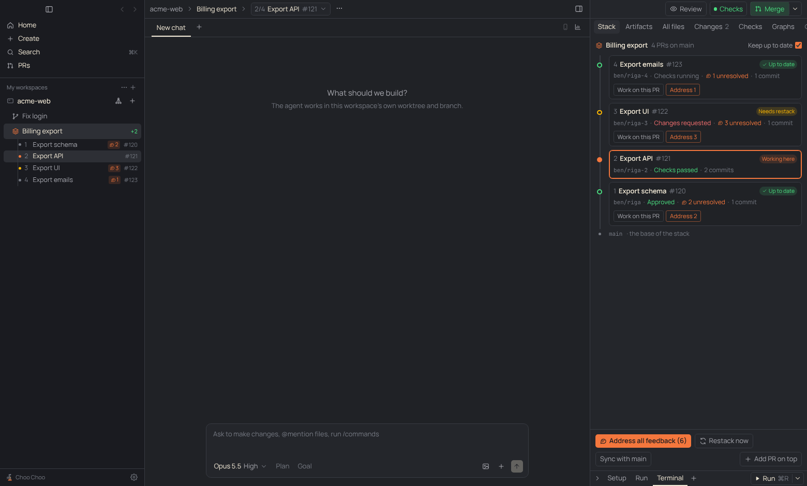
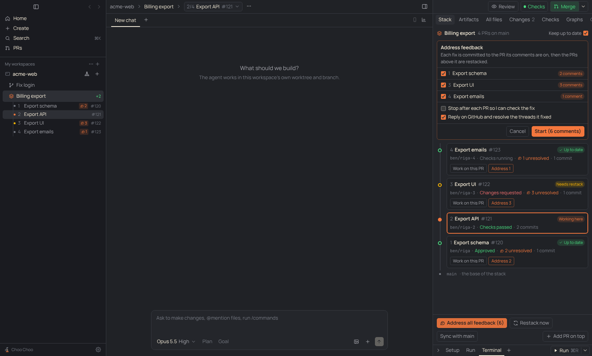

# PRD: Stacked PRs

| | |
|---|---|
| Status | In review |
| Owner | Claude |
| Requested by | Ben, 2026-11-10 |
| Last updated | 2026-11-10 |

## Problem

> we need a way to help manage when there's a stacked PR for one feature set … "Keep all the PRs up to date, but I want to maybe iterate on this one feature" or, "We got feedback on one of the PRs or all of the PRs. How can we address that?"

A big feature often ships as several PRs, each built on the one below. Today a workspace is one branch and one PR, so changing a lower PR means rebasing every PR above it by hand, and feedback spread across the PRs has to be handled one PR at a time with the same rebasing after each fix.

## Goals

- A workspace can hold a stack of PRs for one feature, and the person can see them all in one place.
- Switching which PR the agent works on is one click.
- After a lower PR changes, the PRs above it are rebased onto it and pushed without the person doing git work.
- Feedback on one, some or all PRs in the stack can be handed to the agent in one go, fixed on the PR it belongs to, bottom first.

## Non-goals

- Importing stacks made by other tools (Graphite, ghstack, spr). A workspace on any branch can grow a stack from that branch.
- Merging a whole stack in one click. The bottom PR merges as usual; "Sync with main" then drops it and rebases the rest.
- Several worktrees per stack, or a branch per workspace inside a stack (see [decision 0010](../decisions/0010-one-worktree-per-stack.md)).

## User experience

- **Starting a stack.** The PR menu (the arrow beside the PR status) has "Stack a new PR on top" once the workspace has a PR. It makes a new branch on top of the current one (named after the bottom branch with `-2`, `-3`, …), checks it out, and opens the Stack tab. "Add PR on top" in the Stack tab and the header switcher does the same.
- **Sidebar.** A stacked workspace shows a stack icon. Its PRs are listed under it, bottom first, indented one level further: number, PR title (or branch), comment count, PR number. The PR being worked on has an accent dot; a PR that needs a restack has an amber dot. Clicking one opens the workspace on that PR.
- **Header.** Instead of the branch name, the header shows the workspace title and a switcher pill ("2/4 Export API #121 ▾"). Its menu lists the PRs top to bottom and "Add a PR on top".
- **Switching PRs** checks out that PR's branch in the worktree. The PR button, Checks, Changes and PR comments all follow the checked-out branch, as they do for any workspace. Switching waits for uncommitted changes to be committed.
- **Stack tab** (right panel, first tab, only on stacked workspaces): every PR from top to bottom on a vertical line down to the base branch. Each card shows number, title, PR link, a sync badge (Working here, Needs restack, Not pushed, Merged, Conflicts, Up to date), branch, review or checks state, unresolved comments and commit count, with "Work on this PR" and "Address N".
- **Keep up to date** (switch in the Stack tab, on by default): after each agent turn on a PR that isn't the top one, the PRs above it that fell behind are rebased and pushed, and a note in the chat says which. If a rebase hits conflicts, the conflicts are handed to the agent in the same chat; when its turn ends the restack carries on.
- **Restack now** does the same by hand. **Sync with main** fetches the base branch, drops merged PRs from the bottom of the stack, and rebases the whole stack onto the latest base.
- **Address feedback.** "Address all feedback (N)" (or "Address N" on one PR) opens a panel with a checkbox per PR that has unresolved feedback, "Stop after each PR so I can check the fix", and "Reply on GitHub and resolve the threads it fixed" (on). Start runs, in the active chat: for each PR bottom first, check out its branch, send the PR's comments, wait for the turn, restack the PRs above it. A progress card in the Stack tab lists the steps; Stop ends it; a failure or pause shows Continue.

## Requirements

1. A stack is an ordered list of branches in one workspace and one worktree. Each layer records the parent commit it was last built on.
2. Restacking a layer rebases only its own commits (`git rebase --onto <parent tip> <recorded parent commit> <branch>`), so a lower PR that was amended or rebased doesn't drag its old commits upward.
3. A restack that stops on conflicts leaves the rebase in progress, remembers where it was, and picks up from there on the next restack.
4. After a restack the app pushes, with `--force-with-lease`, every stack branch that is on origin and differs from it, and sets each open PR's base to the branch below it (the bottom one to the default branch).
5. Creating a PR from a stacked workspace targets the branch below.
6. Nothing switches branches or restacks while the worktree has uncommitted tracked changes; the app says so instead.
7. Only one stack operation runs at a time per workspace.
8. Feedback is fetched and fenced exactly as for "Add all comments to chat" ([pr-comments](pr-comments.md)); the agent is told to commit only to the PR's branch and leave rebasing to the app.

## Design

- `src/shared/types.ts`: `Workspace.stack` (`Stack`: layers, `autoRestack`, `restacking`), `StackStatus`, `StackJob`, `FeedbackOptions`.
- `src/shared/stack.ts`: pure helpers: PR base for a branch, next branch name, bottom-first order, feedback steps, the feedback and conflict prompts.
- `src/main/stack.ts`: git and gh work: `addLayer`, `switchLayer`, `restack` (with `ontoBase`), `status`, and the job runner that drives feedback and conflict fixes across agent turns. `onTurnDone` is called from `onChatDone` in `src/main/index.ts`.
- IPC `stack:*` → `window.api.stack*`; `stack:changed` reloads the status into the renderer store (`stacks`).
- `src/renderer/src/components/Stack.tsx`: `StackRows` (sidebar), `StackSwitcher` (header), `StackTab` and the feedback panel.

## Relation to other features

- **PR comments**: same feedback query and prompt, wrapped with stack instructions.
- **Orchestrator** and **Plan board**: unchanged for now. A chain of Plan board tasks that depend on each other could later run as one stack instead of waiting for each merge; an orchestrator tool for restacking is a small follow-up.
- **PRs page**: unchanged; stack PRs show as separate PRs.

## Compliance, privacy and security

- No Claude access changes. Git and GitHub go through the person's own git and `gh` sign-in.
- Review comments come from anyone who can comment on the PR and stay fenced as data (requirement 8).
- Force pushes use `--force-with-lease` and only touch the stack's own branches.

## Testing

`test/stack.test.ts`: helpers, and end to end against real git (a local origin): adding PRs, switching, carrying a lower change up and pushing, status, a conflict handed to the "agent" and finished after its turn, and refusing to switch with uncommitted changes. The built app was driven under Playwright with a stand-in `gh` for the screenshots.

## Rollout

On for everyone; nothing changes until a workspace grows a stack. "Unstack" isn't in the UI yet (`stackDissolve` exists).

## Open questions and future work

- Plan board: run a dependency chain as a stack.
- Orchestrator tool: restack and address feedback across stacks.
- Group a stack's PRs together on the PRs page.
- Merge the bottom PR from the Stack tab, then sync automatically.
