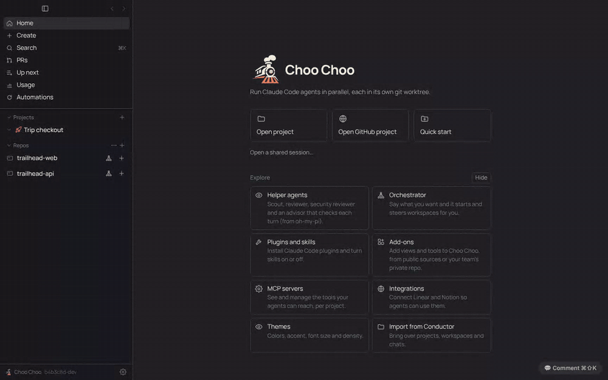

# PRD: Stop that always stops

| | |
|---|---|
| Status | In review |
| Owner | Choo Choo maintainers |
| Requested by | Ben, 2026-11-13 |
| Last updated | 2026-11-13 |

## Problem

> Sometimes it's very hard to tell when the stop buttons actually do anything. I click them, but they don't always seem to actually stop whatever's in progress. So it feels stuck.

Stop asked Claude Code to interrupt and then waited for it, with no time limit and no feedback. When Claude Code was busy (a long Bash command, a stuck tool, a process that wouldn't exit), nothing visible happened and nothing tried harder. Some stops also didn't stick: a message queued while Claude worked started a new turn right after the stop, a stopped orchestrator was woken up again by its workspaces finishing, a stacked-PR job took its next step, and a chat being stopped when the app quit was picked up again after the restart.

## Goals

- Pressing Stop always ends the turn, within seconds, even when Claude Code doesn't respond.
- The person sees right away that the stop registered, and sees clearly when it's done.
- A stopped chat stays stopped until the person writes again.

## Non-goals

- Stopping one background task without stopping the turn (that's the Stop next to each task, unchanged).
- Undoing what the agent already did. Revert to here does that.

## User experience

1. Press Stop (or Esc) while Claude works. The button turns into **Stopping…** and the chat's "Working…" line says **Stopping…**.
2. Usually the turn ends within a second. The chat shows a **Stopped by you** rule where the turn ended. Tool calls it cut off, a subagent's included, show as stopped instead of spinning.
3. If the turn hasn't ended after a few seconds, the button turns red and says **Force stop**. Clicking it (or pressing Stop or Esc again at any point) kills Claude Code and every process it started. The marker then says it was force stopped.
4. Messages queued to run after the turn don't run. They are marked "Not sent" and go back into the message box, and the marker says so.

## Requirements

1. Stop shows "Stopping…" immediately, before Claude Code answers.
2. Stop escalates on its own: Claude Code's interrupt (as Esc does in its terminal), then closing the process, then killing it and its child processes. Each step waits a few seconds (`stopTimings` in `src/main/agent.ts`).
3. Pressing Stop again while stopping goes straight to the kill.
4. A stopped turn ends with a "Stopped by …" marker, never "Finished with errors". Stops by the orchestrator say so.
5. Messages queued into the turn, or waiting for it to end, don't start a new turn after a stop; their text goes back to the message box.
6. After a stop, nothing restarts the chat on its own: no advisor follow-up, no Up next pause, no orchestrator auto-update wake (from the stopped chat or into a stopped orchestrator), no next stacked-PR step, and no pick-up after a restart or crash. Writing a new message clears this.
7. Codex turns get the same escalation: Ctrl-C, then SIGKILL.

## Design

- `agent.stop(chatId, { force, by })` in `src/main/agent.ts` drives the escalation and resolves once the turn has ended. Each running turn keeps its process id, a `done` promise, and a `forceEnd` that makes the message loop give up on a stream that never ends (`untilForced`).
- Claude Code is spawned by the app through the SDK's `spawnClaudeCodeProcess` option (same command, arguments and environment the SDK chose), so the app knows its pid. `src/main/processTree.ts` lists descendants with `ps` and kills the tree; processes snapshotted at stop time are only killed if they still run the same command, so a reused pid is left alone.
- `Chat.stopping` (persisted) drives the UI and tells `markInterrupted()` and `store.load()` not to resume the chat. `agent.wasStopped()` tells `onChatDone` in `src/main/index.ts` to hold queued messages, orchestrator wakes and stack jobs.
- IPC: `stopChat(chatId, { force })`. Chat events can carry `draft` to put text back in the message box.

## Compliance, privacy and security

- Claude access is unchanged: the official Agent SDK runs the person's own Claude Code binary ([decision 0001](../decisions/0001-official-claude-access-only.md)). The app only takes over spawning it to learn its pid.
- Nothing leaves the machine.

## Testing

`test/stop.test.ts` drives `agent.send` with a stand-in SDK whose Claude Code ignores interrupts, hangs after them, ignores closing, or has queued messages; on the old code five of these cases never finish. It also kills a real process tree that ignores SIGTERM. The demo stand-in `claude` (`scripts/demo/bin/claude`) runs real shell commands for tool calls and has a `stuck` mode; the `stop` and `stop-queued` scenes check the command's process is gone.

## Rollout

On for everyone. No settings.

## Open questions

- None.
