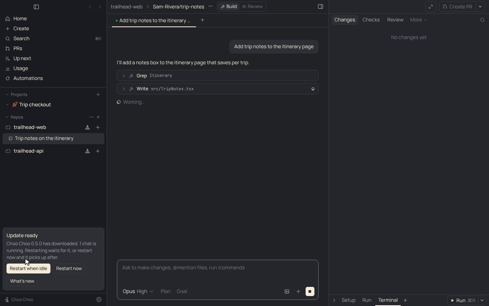
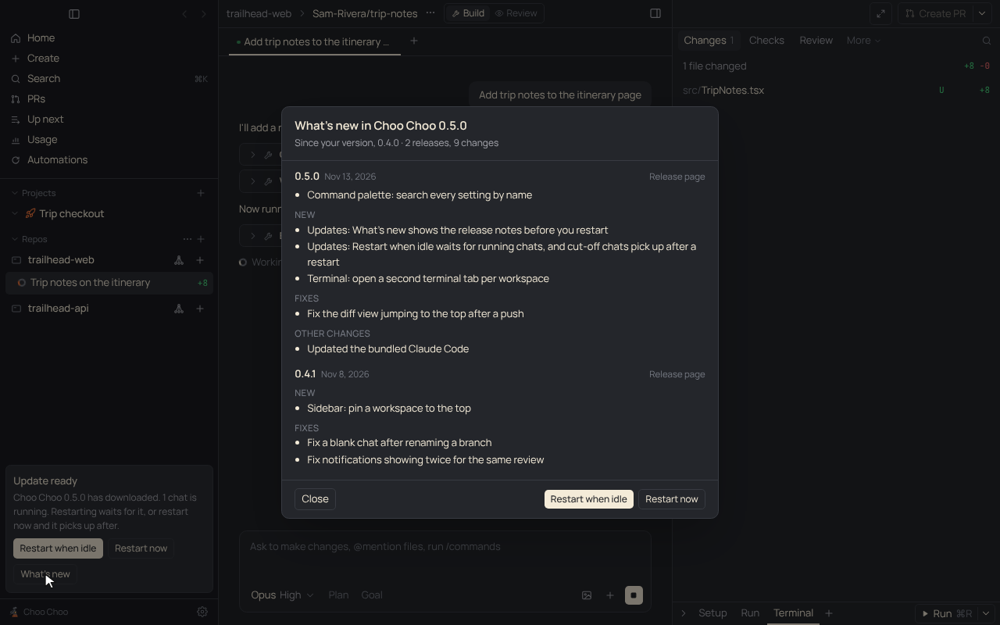
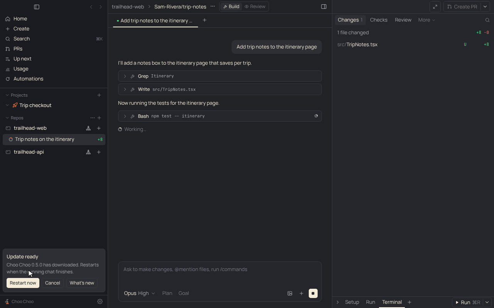
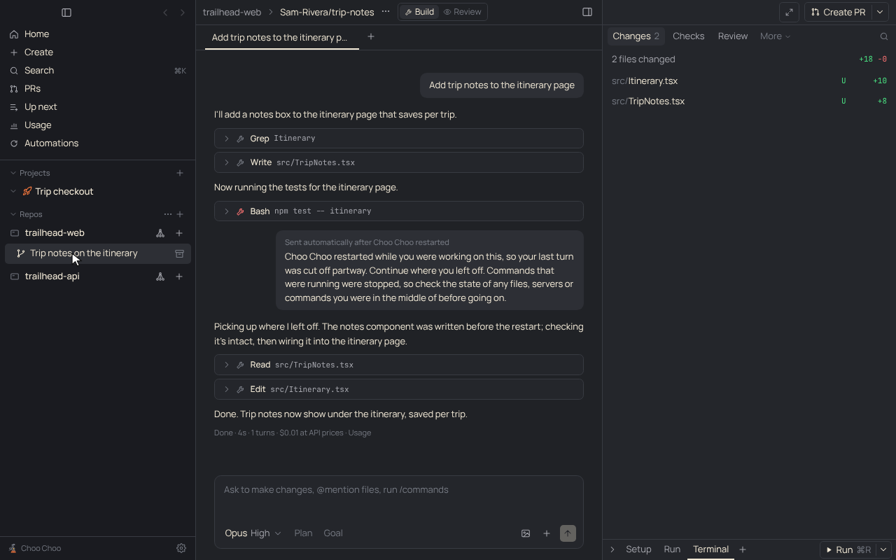

# PRD: Update checks for Choo Choo and Claude Code

| | |
|---|---|
| Status | Shipped (PR #39); beta channel added; What's new and Restart when idle added |
| Owner | Claude |
| Requested by | Ben, 2026-11-06 |
| Last updated | 2026-11-13 |

## Problem

Ben asked whether the app runs real Claude Code or the API, because "we'll want checks for when our app is updated, or when Claude Code has an update", and that the checks should be "in the settings to turn on or off".

On 2026-11-10, with signing working, Ben asked that "every PR we merge is an update to the application" for people who opt into a beta or bleeding-edge setting, while everyone else stays on manually published releases.

On 2026-11-13 Ben asked for two more things. When an update is ready, explain what's in it, for example with a button next to "Restart to update". And restarting shouldn't kill running work: either sessions survive a restart, or the restart waits until no session is in progress.

Agents run the real Claude Code binary. By default it's the copy bundled with the Agent SDK; Settings can pick your installed `claude` instead. Before this, only signed builds could find app updates, and nothing showed the Claude Code version.

## Goals

- See the Choo Choo and Claude Code versions in one place.
- Hear about a new Choo Choo release, and install it, whether the build is signed, unsigned, or installed by Homebrew.
- Hear about a new Claude Code release, and update an installed `claude` from the app.
- Turn each automatic check on or off.
- Pick an update channel: Stable (published releases) or Beta (a signed build of every merge to main).
- See what an update brings before restarting into it: every release between your version and the new one, in plain words.
- Never lose a running chat to an update. The restart waits for running chats, and a turn that a restart, quit or crash cuts off picks up again when the app opens.

## Non-goals

- Updating the bundled Claude Code on its own. It changes only with a Choo Choo release (it's inside the signed app).
- Keeping a turn alive across the restart. The agent's Claude Code process is a child of the app and stops with it; what survives is the session on disk, which the next launch resumes (decision 0021).
- Restarting terminals and Run scripts. They stop with the app, as before.

## User experience

Settings > Updates has an **Update channel** menu (Stable or Beta, Stable by default), a toggle for each check (both on by default), the current versions, the result of the last check, "Check now" buttons that work even with a toggle off, and an install or update button when one applies. The sidebar shows a card when a Choo Choo update is available or downloaded, and a dismissible card for a new Claude Code. The app menu's "Check for Updates…" uses the same paths.

**What's new.** Next to the install button, on the sidebar card and in Settings, a **What's new** button opens the release notes of every version after yours up to the update, newest first, each with its date and a link to its release page. The notes are the GitHub release bodies cut down for people using the app: no download steps, PR numbers, authors, docs-only or CI changes, and dependency bumps are left out except a new bundled Claude Code ("Updated the bundled Claude Code"). A change listed in a newer release isn't repeated in an older one.

**Restart when idle.** With no chat running, the button says **Restart to update** and restarts right away. While chats run, the card says how many and the button says **Restart when idle**, with **Restart now** beside it. Restart when idle waits, says "Restarts when the running chat finishes", and restarts the moment the last one does; **Cancel** stops waiting (the update still installs the next time you quit). Restart now restarts at once, and the cut-off chats pick up after.

**Picking up after a restart.** When the app quits, restarts or crashes during a turn, the next launch sends that chat a message in the same Claude Code session telling Claude it was cut off and to carry on, after checking the state of what it was in the middle of. The message is marked "Sent automatically after Choo Choo restarted", and tool calls that were cut off show as stopped. Settings > Updates > **Pick up interrupted chats after a restart** (on by default) turns this off; then the chat gets a note saying what happened instead.

 The sidebar footer shows the running version next to "Choo Choo": `v<version>` in a packaged build, `<short sha>-dev` under `npm run dev` (hover for version and commit).

## Requirements

1. With its toggle on, each check runs 5 seconds after start and every 6 hours.
2. Signed builds download the update in place and offer "Restart to update".
3. Unsigned builds offer `brew upgrade --cask choo-choo` (then relaunch) when Homebrew installed the app, otherwise the release page.
4. The Claude Code version comes from the SDK's `claudeCodeVersion` (bundled) or `claude --version` (installed), compared with `@anthropic-ai/claude-code` on npm.
5. An installed `claude` updates with `claude update`. A bundled one that's behind offers switching to the installed `claude` when one exists.
6. On Beta, the app checks the newest of the recent releases, prereleases included, and the updater may download prereleases. On Stable, only the release marked Latest.
7. Never downgrade. Switching from Beta to Stable keeps the beta build until a stable release is newer than it.
8. Every merge to main that changes more than docs publishes a signed, notarized prerelease `v<next>-beta.<run>`, where `<next>` is Release Drafter's next version. It's a draft until all files are uploaded. Only the 10 newest betas are kept.
9. Prereleases never go to Homebrew and never trigger the Release workflow. There's no beta cask: Homebrew users install the stable cask and switch to Beta in Settings, since signed builds update themselves.
10. Each stable release points `Casks/choo-choo.rb` in `Benbentwo/homebrew-tap` at its dmgs (the Homebrew cask workflow, called by Release and runnable by hand). Signed releases get `auto_updates true`.
11. What's new lists every non-draft release after the running version up to the update, newest first; Stable shows only stable releases. On Beta, a stable release in the range stands in for the betas older than it. Each change appears once, under the newest release that lists it.
12. Installing an update that restarts the app (a downloaded update, or a Homebrew upgrade) waits while any chat has a turn running, unless the person picks Restart now. The running count updates every 2 seconds, and the restart happens when it reaches 0.
13. Quitting while turns run marks those chats as interrupted (with the reason: update or quit) before stopping them. A chat still saved as running at launch, with no mark, was cut off by a crash or a killed process.
14. On launch, each interrupted chat whose workspace still exists, isn't archived and isn't continuing elsewhere (phone, cloud, Claude desktop) gets the resume message as a new turn in its own session (`resume` with its session id; Codex chats resume their thread). Out of usage, it joins the top of Up next instead. With the setting off, it gets a note.
15. Beta release notes list every PR merged since the previous beta, since a newer merge cancels a beta build in progress and docs-only merges don't build. Path labels (`docs`, `ci`, `dependencies`, `tests`) only go on PRs that change nothing else, so a feature that touches a workflow or `package.json` stays out of the Maintenance section of the stable notes.

## Design

- [`src/main/updater.ts`](../../src/main/updater.ts): both checks, update method detection (`codesign` Developer ID check, Homebrew Caskroom), installs, menu dialog.
- [`src/shared/updates.ts`](../../src/shared/updates.ts): `UpdateStatus` and version parsing and comparison.
- [`src/renderer/src/components/Updates.tsx`](../../src/renderer/src/components/Updates.tsx): Settings tab and sidebar cards.
- `Api`: `updateStatus`, `checkForUpdates`, `installAppUpdate`, `updateClaude`, `onUpdateStatus`.
- Settings: `checkAppUpdates`, `updateChannel`, `checkClaudeUpdates`, `resumeAfterRestart`.
- [`src/shared/releaseNotes.ts`](../../src/shared/releaseNotes.ts): parses release bodies (`parseNotes`, `cleanItem`) and picks the releases between two versions (`notesBetween`). The main process fetches the 100 most recent releases once per update (`Api.releaseNotes`).
- [`src/shared/restart.ts`](../../src/shared/restart.ts): `Chat.interrupted`, the resume message, which chats to resume, and the card's wording. Why resume the session rather than keep the process alive: [decision 0021](../decisions/0021-restart-waits-then-resumes.md).
- `src/main/updater.ts` takes a `busy` count from `agent.runningCount()`; `installAppUpdate({ now })` and `cancelRestart()` drive the wait. `agent.markInterrupted()` runs in `before-quit`; `resumeInterrupted()` in `src/main/index.ts` runs 3 seconds after launch. `store.load()` marks chats still saved as running.
- `AppUpdateStatus.running` and `restartWhenIdle` carry the wait to the UI.
- [`.github/workflows/beta.yml`](../../.github/workflows/beta.yml): runs after Release Drafter on each push to main, creates a draft prerelease, builds with `-c.publish.releaseType=prerelease` (electron-builder writes `beta-mac.yml`), checks signing, publishes, prunes old betas. Manual runs are dry runs by default. Why prereleases and not drafts: [decision 0015](../decisions/0015-beta-channel-uses-prereleases.md).
- Dependabot opens a PR for each new Agent SDK; merging it and releasing ships the newer bundled Claude Code.

## Compliance, privacy and security

- Runs only the unmodified Claude Code binary (`--version`, `update`), per [decision 0001](../decisions/0001-official-claude-access-only.md).
- Sends anonymous GET requests to api.github.com (latest release, or the 30 most recent on Beta, and the 100 most recent for What's new) and registry.npmjs.org (latest Claude Code). No user data.
- Release notes render as plain text, never as HTML or Markdown, so a release body can't inject markup.
- Resuming sends a fixed message into the chat's existing session through the Agent SDK, like the person typing it.

## Testing

`test/updates.test.ts` covers version parsing and comparison, including numeric beta ordering (`beta.10` after `beta.9`). `test/release-notes.test.ts` covers cleaning release bodies (stable and both beta formats) and picking releases per channel. `test/restart.test.ts` covers which chats resume. Install paths need a packaged build to try by hand.

The screenshots come from the real app with the demo stand-ins (`node scripts/demo/record.cjs app-updates resume-after-restart` with `CHOO_DEMO_SHOTS`): `CHOO_DEMO_UPDATE` gives a source build a made-up downloaded update and release list, and the resume scene really quits the app mid-turn and opens it again.

## Rollout

Both toggles default on and the channel defaults to Stable. Betas reach only people already on a signed build, so the first signed stable release has to go out first. Older saves pick up the defaults through `DEFAULT_SETTINGS`.

## Open questions

- None.

## Future work

- Show which Claude Code the next Choo Choo release bundles.
- Hold automatic starts (automations, Up next) while a restart waits, so a busy app still gets to idle.
