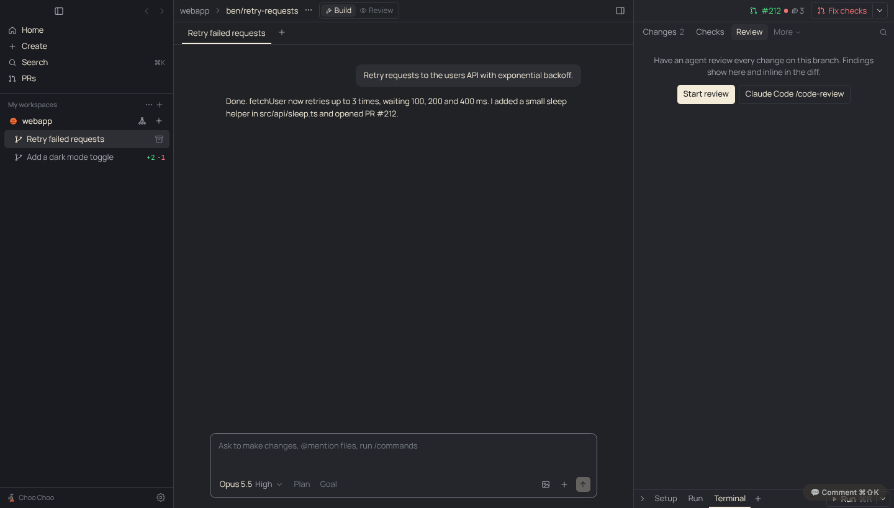
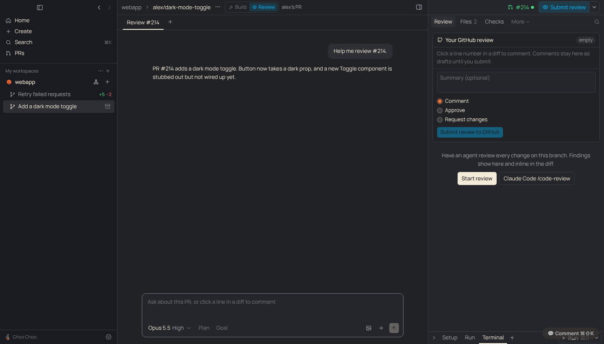

# PRD: Build and Review workspace modes

| | |
|---|---|
| Status | In review |
| Owner | Choo Choo maintainers |
| Requested by | Ben, 2026-11-12 |
| Last updated | 2026-11-12 |

## Problem

Ben: "Our UI is a little bit crowded now, and there's a lot of buttons that are kind of confusing ... the main area to focus on is the top right, the Create PR button ... Maybe we should have context of whether a work tree is a PR review work tree or a development work tree that you own. Perhaps you should be able to switch between the two in case you're collaborating on a PR, but I think we need to make sure that there's simplicity."

On a workspace with an open PR, the top right held a Review button, a comments pill, a checks pill, a PR button and its menu, and the header added an owner pill, a split button, and phone, Claude desktop and usage icons on the chat tab bar. Six right-panel tabs showed whatever you were doing. Whether you were building or reviewing changed what most of them did, but only a small pill said so.

## Goals

- One clear answer to "am I building this or reviewing it?", picked for you and easy to switch.
- The top right shows the PR at a glance and one button for the next step.
- Fewer buttons on screen; nothing removed for good, only moved.

## Non-goals

- Blocking `git push` in Review mode. The agent is told not to push (as before); it isn't sandboxed.
- New review features (walkthroughs, viewed files). Those are separate.

## User experience

- **Build | Review switch** in the workspace header, after the branch. It starts in Review on someone else's open PR and in Build everywhere else. Clicking the other side switches; clicking back to the automatic choice forgets the override. On a coworker's PR the switch is followed by "alex's PR" (Review) or "on alex's PR" (Build, for collaborating); its tooltip says whether you approved.
- **Top right**: a PR chip (`#212`, a checks dot, a comment count) that opens the PR on GitHub, and one primary button.
  - Build: Create PR, then Resolve conflicts, Fix checks, Address N comments, Merge, in that order of need. Otherwise it states where the PR is (Waiting for review, Checks running, Mark ready, Merged). Its menu holds Open on GitHub, Fix failing checks, Squash and merge, Add all comments to chat, Mark ready, Update branch and Stack a PR on top.
  - Review: **Submit review (N drafts)**, which opens the Review tab with your GitHub review. Merge, stacking and adding comments to chat are hidden.
- **Right panel tabs**: Build shows Changes, Checks, Review (and Stack). Review shows Review, Files, Checks (and Stack). All files, Artifacts and Usage (was Graphs) are under **More**. Reviewing opens on the Review tab.
- **Line comments** default to your GitHub review in Review mode and to the agent in Build mode. Agent answers to queued comments and GitHub threads advise and suggest, without pushing, in Review mode.
- **Composer** placeholder in Review: "Ask about this PR, or click a line in a diff to comment".
- **Moved to the ⋯ workspace menu**: Usage and context, Continue on phone (beside Open in Claude desktop and Run in the cloud). Split right stays in the menu's pane section and on ⌘\. The chat tab bar keeps only tabs and +.

## Requirements

1. The default mode is Review only for an open PR whose author isn't the signed-in gh user.
2. A manual choice is kept per workspace on this computer and wins over the default.
3. The mode, not PR ownership, sets the line-comment default and whether agent prompts say not to push.
4. Approve and Request changes stay limited to other people's PRs (GitHub refuses them on your own).
5. Every action that left the header is still reachable from a menu or shortcut.

## Design

- `src/shared/prReview.ts`: `WorkspaceMode`, `defaultMode(info, pr)`, `modeDest(mode, pr)` (replaces `defaultDest`).
- `src/renderer/src/prReview.ts`: `useWorkspaceMode(ws)` returns `{ mode, auto, set }`; overrides live in the store's `wsMode` and `localStorage.wsMode`.
- `store.reviewTarget(r, mode)` follows the mode when given.
- `Center.tsx`: `ModeSwitch` replaces `PrOwnerPill`; split, phone, desktop and usage buttons leave the header and tab bar.
- `RightPanel.tsx`: tabs per mode plus More; the PR button renders the chip and one primary action per mode.
- `DiffView.tsx`, `ReviewDrafts.tsx`, `RightTabs.tsx`, `Composer.tsx` read the mode.
- See [decision 0016](../decisions/0016-build-and-review-modes.md).

## Compliance, privacy and security

- No change to Claude access, sign-in or data leaving the machine.

## Testing

`test/pr-review.test.ts` covers `defaultMode` and `modeDest`. Checked in the built app under xvfb with a stand-in gh: own PR with a failing check and comments (Build), a coworker's PR (Review), switching a coworker's PR to Build, and the menus.

## Rollout

On for everyone. No migration: workspaces start in the mode their PR implies.

## Future work

- Review-mode extras from the Gnosis comparison: guided walkthrough, viewed files and "changed since your last review".
